# BOCHK 中银香港开户攻略 | 线下开户资料要求｜线上开户详细流程 | 避坑指南

BOCHK中银香港和汇丰、渣打一起，是香港的三大发钞行。

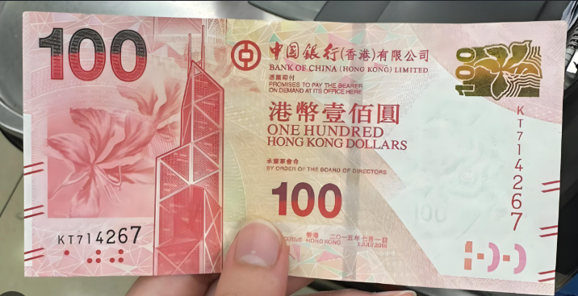

## BOCHK账户优势

- BOCHK中银香港账户无强制存款要求，0 管理费。
- 内地中银和香港中银之间同名账户转账0跨境转账费。
- BOCHK背靠内地的中国银行，很多用户也正是看中了这一点选择中国银行，当然也有很多用户是因为这一点而不选择中国银行，仁者见仁，智者见智。

## 中银香港开户方式

1. 线下：柜台预约开户，需提供资料，具体参考后面内容
2. 线上APP 申请：在香港境内用中银香港手机APP提交流程申请，卡片邮寄。（通过率低）

## 中银香港线下柜台开户流程

香港的银行开户大都需要预约，中银香港也不例外，自行前往很可能无法办理。

### 1. 预约方式

1. WX小程序【中银香港】预约，只能预约7天内的号，通常需要靠抢，每晚12点开始放号。
2. 如果实在预约不到也可以在银行9点开门前去排队walkin，此方式无法保证能够拿到号
3. 实在约不上，或者约不到理想的时间，也可以找我预约+资料准备指导（vx: hkxiaowan）

### 2. 线下开户所需资料

- 港澳通行证：有效期大于3个月
- 身份证：有效期大于3个月
- 过关小白条：入境香港时会自动发放给你，很小的一张白纸，千万要保留好
- **辅助证明资料：**
  1. **投资证明**：本人的A股或港股的证券投资记录，必须是股票的，基金不认，通常要求3个月，可直接出示手机App和交易记录即可。
  2. **资金证明**：如工薪阶层，则直接提供工资流水，如工商企业主，则提供对应的银行流水账单和存款证明。具体金额多少，没有明确要求，通常至少需要维持余额 10 万以上。
  3. **地址证明**：开户时需填写一个收件地址，用于接收实体卡片。如该地址跟身份证一致，则直接出示身份证即可。如不同，则还需对应的水电，煤气，信用卡账单，且账单对应的地址为本人实际居住地址。如下图所示官方的水电账单，不能是物业手写的那种。

### 3. 线下开户可能会被问到的问题

1. 为什么开卡？ 直接回答投资，储蓄即可。
2. 有过投资经验？ 请出示你的投资记录？ 直接出示你的A股和港美股投资App记录。
3. 准备投资什么？请说几个股票的代码？ 如VOO标普500指数，小米，英伟达之类的。
4. 准备投入多少钱，资金来源是什么？钱怎么转过来？ 如准备投入10-50，通过内地转过来，来源是工资。
5. 当前住在哪里？有没有居住记录证明？ 如实回答即可，如跟身份证不一致，就出示水电煤气等账单。

如果答的明显不合逻辑，客户经理有权直接拒绝你的开户申请。

小万就看到过有人带着大妈大爷过去开户的，客户经理一问开卡做什么？答：投资。问：投资什么？答不上来。这种一看就是拿来开户凑人数的。银行经理会直接拒绝你的开卡申请。

所有问题背后都只有一个目的：**证明你是合规合法，且对银行有价值的用户。**

搞清楚了这个逻辑，你就知道怎么回答问题了。

## 中银香港App线上开户流程（通过率低）

中银香港线上 APP 申请通道目前普遍反馈通过率低，如果只有一次去香港的机会，不要把希望全寄托在线上申请这个渠道。

### 1. 线上开户要求

1. 人必须在香港境内才能申请，App流程会检验GPS定位，且需要12367的出入境记录。
2. 港澳通行证和身份证。
3. 实体卡会以邮寄的方式给到你，约需1个月。
4. 线上开户的账户每天限额20万港币，如需要提额，则还是需要去线下补签名。

### **2. 出发前准备工作**

1. 检查证件：港澳通行证（有效期需大于6个月）、身份证原件；
2. 手机开通香港漫游，并能接收短信验证码；
3. 确保自己的手机应用市场可以下载到BOC HK App程序，如果没有则只能到中银官网去下载了。注意官方的App标识。

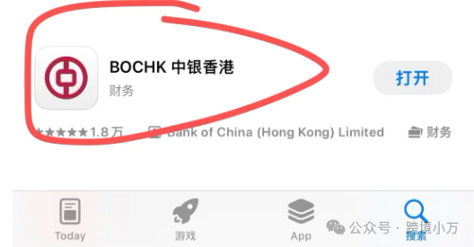

### **3. 12367出入境记录下载**

1. 过关后随便找一个商场或者银行分行连接上香港的Wifi，一定要连香港wifi，内地手机开通漫游也可能无法识别为香港。
2. 微信搜索“移民局12367小程序”，点“出入境记录查询”，下载记录文件保存，留待后面开户的时候使用；

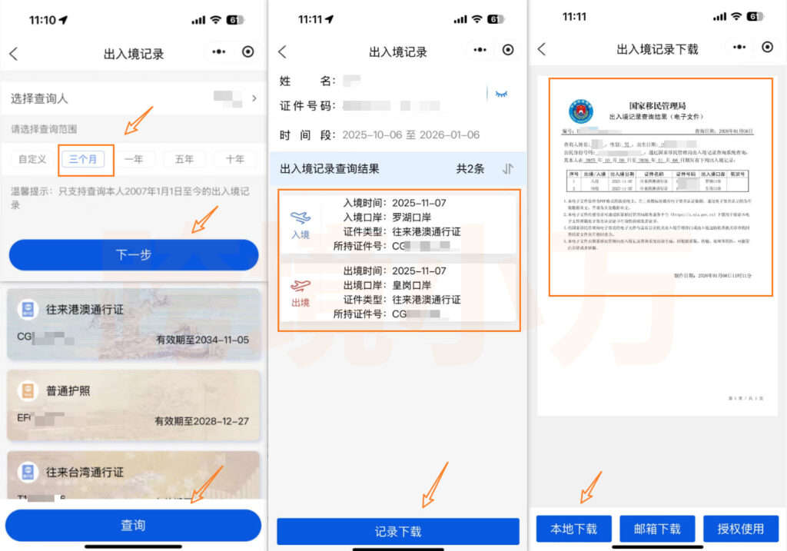

### **4. 线上开户流程**

**1. 打开BOCHK App**，选择【开立账户】，然后按下图依次选择

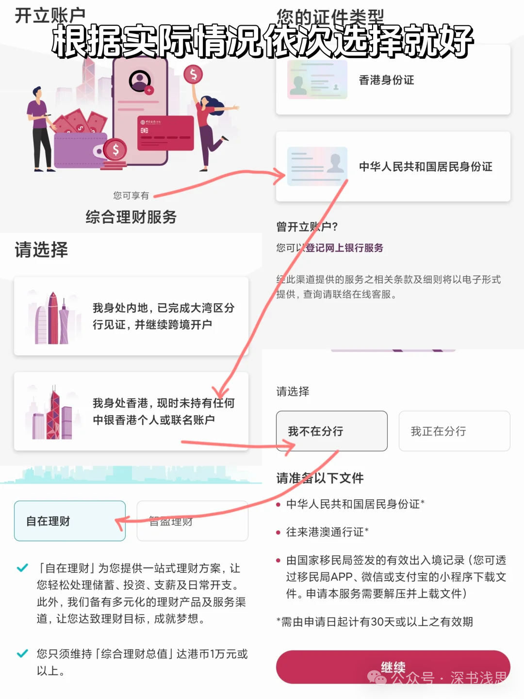

选【自在理财】，这个是没有存款要求的，App说需要存入1万元，实际不会管。

当然，你开了这个账户肯定是有转账和使用需要才用的，否则就没必要开了。开了不用，如果2年内没有资金往来活跃记录，账户会被冻结，到时候就只能到线下去重新激活了。

**2. 上传出入境记录**：按提示上传刚才保存的出入境记录，不要改动任何内容。

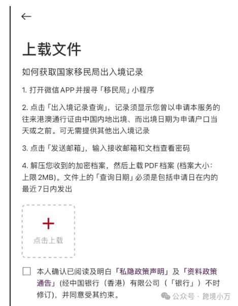

**3. 身份识别和验证**：这一步比较繁琐，需要身份证和港澳通行证验证。

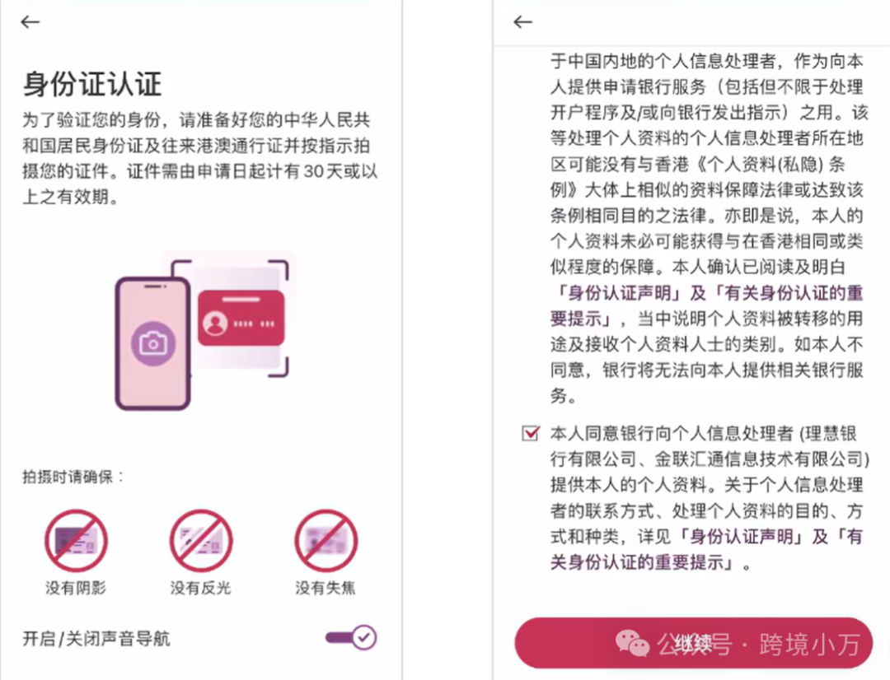

只需把身份证放到对应的框框中，自动识别成功后才能继续下一步。需注意证件照片的清晰度问题。

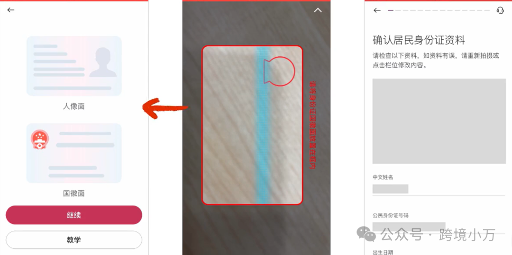

这一步如果始终无法自动识别，一个办法是用另外一个手机或者ipad先将证件照片拍下来，然后放大，再用申请手机对着放大后的照片识别。

**4. 人脸识别**

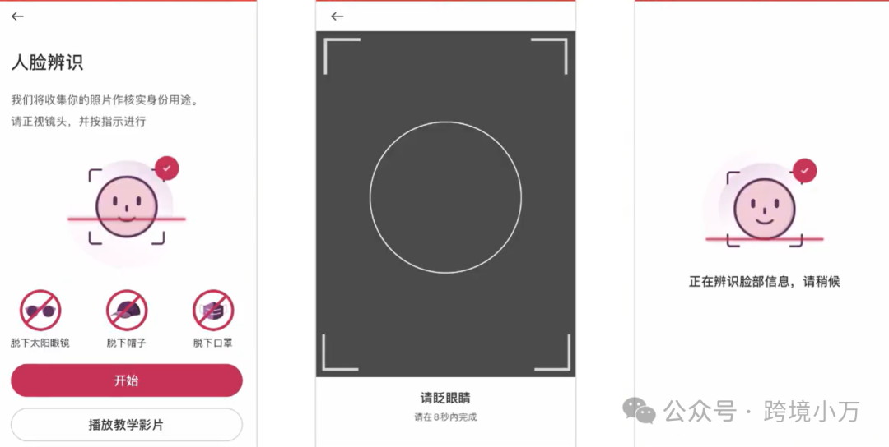

成功后，再进行港澳通行证的验证，同样过程。

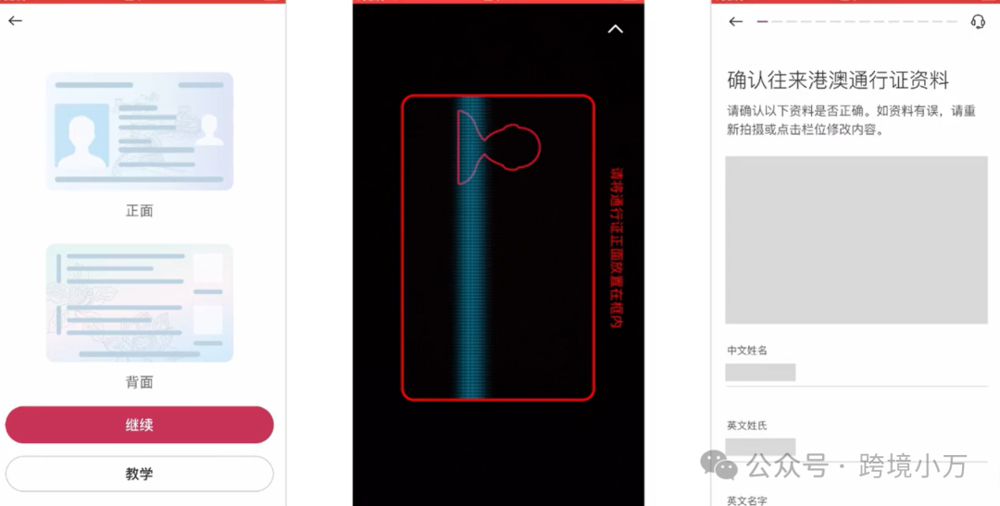

**5. 选择投资目的等其他辅助信息**：最好选【储蓄和股票，保险投资】，职业选大家都熟悉的职业，如工程师之类的，如实填写即可，但不要写一看上去就不正经的职业，如KTV经理。

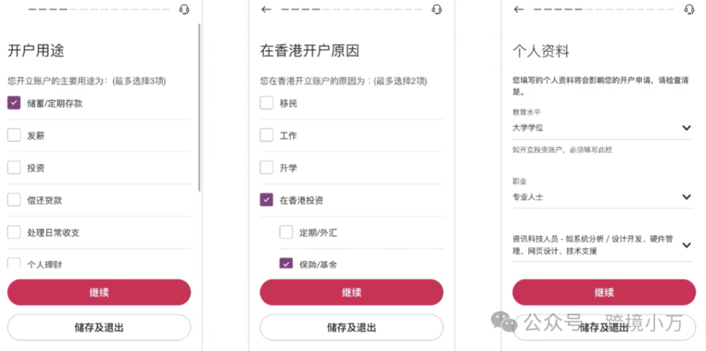

**6. 个人资料和资金来源：**根据实际情况如实填写即可，不要写的太夸张，否则会触发审核风险。

**7：填写联系地址：**地址就填你内地的实际住址，用于接收实体卡片，会以平邮方式邮寄给你，中银支持中文填写地址。

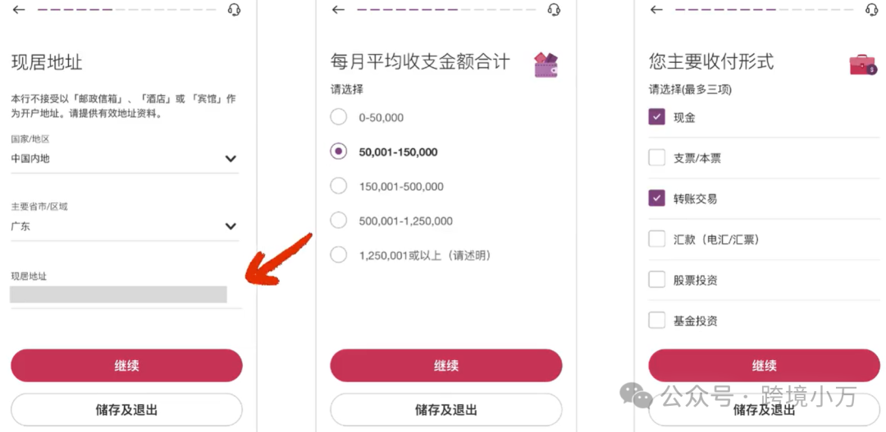

**8. 收付形式：**即你的钱怎么存到银行卡里面，根据实际情况填写即可，不知道就选现金和转账。

**9. 最后一步**，确认信息

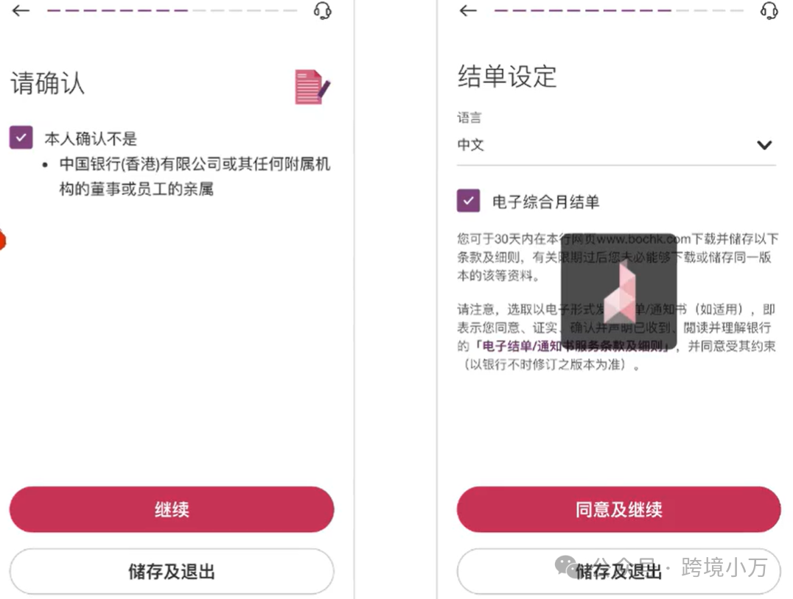

登记发薪账户不要勾选，除非你在香港工作。

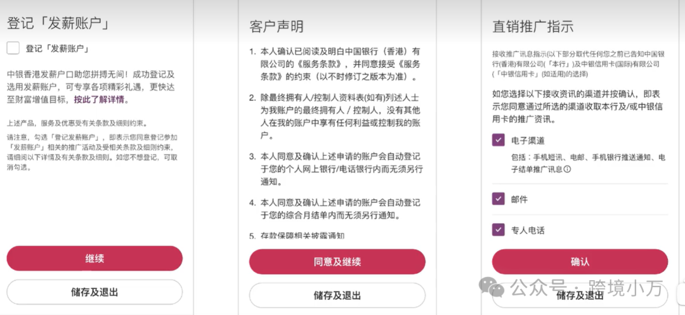

**10. 开户成功通知**，如一切信息填写无误，会当场收到账户开通成功通知。

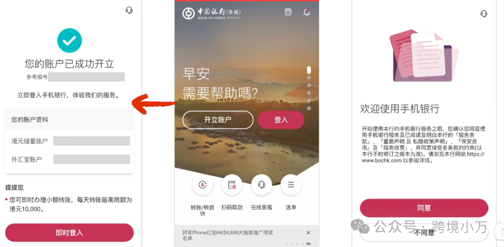

如果遇到名字重名就会触发后台风控审核，具体参考文章后面FAQ内容。

**11. 注册手机网银密码**：选择【即时登入】，回到App首页，选择登录，设置账号和【登录密码】，**密码为9-12位组合，千万注意保管好账号和密码**。

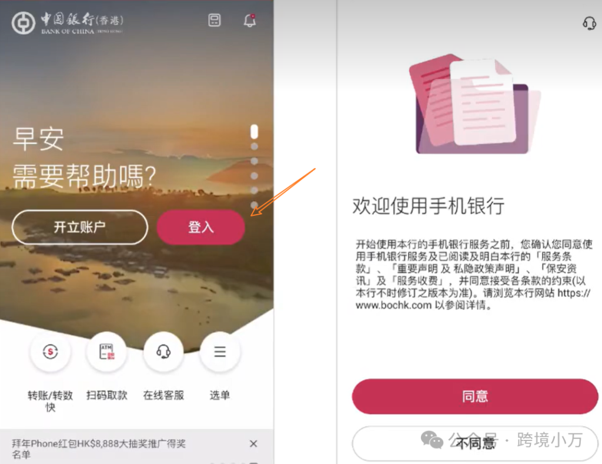

**根据需要开启流动保安设置**：流动保安的意思就是下次打开App时，不用输入密码，直接用指纹和脸部识别就可以登录BOCHK的App。

所有流程走完后就进入到上面的银行App界面，到此成功完成。

欢迎进入金融自由的世界，如需开通香港券商证券账户，可联系我个人VX：kuajingxiaowan（跨境小万）.

## **中银香港线上开户避坑指南**

**1. 申请结果为【已接收指示】，【申请正在处理中】怎么办？**

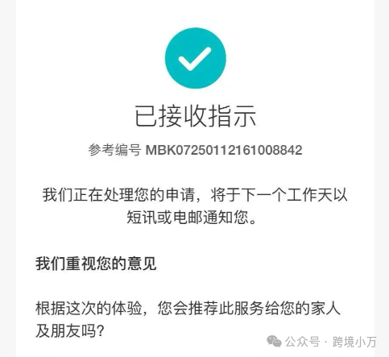
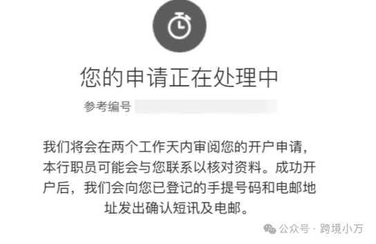

答：正常等待短信或email邮件通知就好了，不用急。最多3-7个工作日会收到开通成功，通过后就可以设置密码登录网上银行使用了。

**2. 无法验证您的证据，请重新尝试怎么办？**

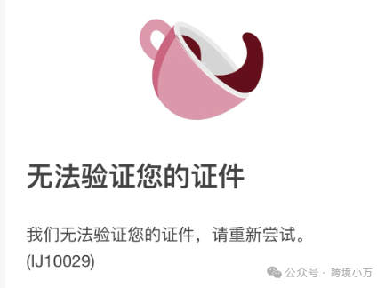

答：这个问题多为证据照片拍摄不清晰造成的，拍照时避免反光，重新提交流程即可。

**3. 您未能符合本行尽职审查考量，这是什么情况？**

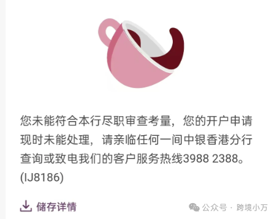

答：这种情况多为重名（2个字的名字很容易重名），且名字可能与银行黑名单有关联，这种就只能去线下了。**最后提醒：不要将卡借给别人使用，这是基本常识。**

