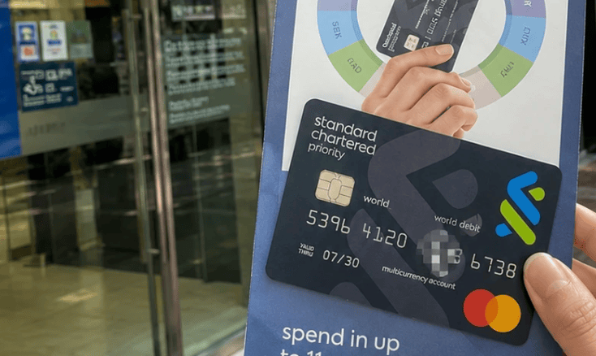
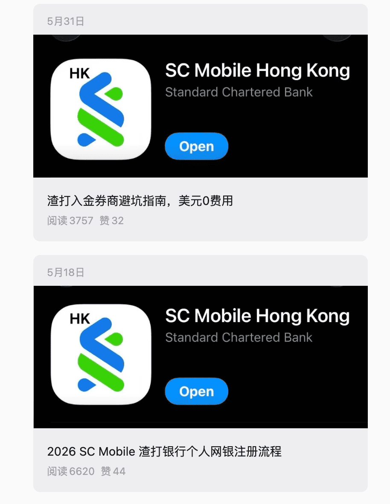

# 2026 渣打香港开户指南

香港渣打银行和汇丰、中银香港一起，是港币的三大发钞行。

渣打**是一家纯粹的外资银行**，渣打是所有香港银行里面受内地影响最小的银行。如果你有大额海外资产，同时又特别注重账户的隐私性，可以重点考虑渣打账户。

目前内地居民只能申请渣打银行的 **渣打优先理财 Priority Banking** VIP 账户。

优先理财账户有最低存款要求，否则会被收取管理费，具体如下：
- 渣打香港优先理财账户最低存款要求为 100 万港币。
- 渣打新加坡优先理财账户的最低存款要求是20 万新币（约 110 万 RMB)。
- 渣打中国优先理财账户的最低要求是 50 万 RMB。

如同时开通了多个地方的账户，只需要满足一个地方的优先理财要求即可豁免名下所有账户的管理费。

## 渣打香港适合哪些人？

- 大额海外资产配置，如长期储蓄、投资、移民等；
- 拥有海外身份税号，希望用中国护照+海外税号开户，或者第二护照身份进行开户；
- 不出境，内地远程见证开立香港、新加坡、迪拜、马来西亚等地账户。

## 渣打香港的两种开户方式

目前，内地居民开立渣打香港账户，常见的方式主要有以下两种：

### 1. 香港分行预约开户

第一种方式，是本人前往香港，通过预约到渣打私行中心办理优先理财账户。

这种方式的优点是速度相对快，开户成功后通常可以现场拿到银行卡，同时会有专属客户经理协助完成开户和后续维护。

**需要准备以下材料：**

- 中国内地身份证和大于3个月有效期的港澳通行证
- 开户人名下50万RMB 资产证明（无需冻结，活期、理财、股票均可，需要当场核验）
- 10000港币或等值外币现金，用于账户开通过后激活使用，需当场存入。

**需要注意：**

- 账户开通后的 6 个月内，需要满足 100 万港币或等值资产的长期余额要求。
- 前半年豁免管理费，后期如果不达标，会被收取 900 港币/季度的管理费。
- 半年后可电话申请降级为普通免管理费账户 Easy Banking。

### 2. 内地分行见证开海外账户（不用到香港或新加坡）

如果暂时不方便出境，可以考虑通过渣打中国远程见证，远程开立香港渣打或者新加坡渣打等地账户。
这种方式的基本流程是：

1. 本人持身份证按预约时间前往渣打内地分行，先开立渣打中国账户；
2. 向内地账户存入 50 万人民币或等值外币，达到渣打中国优先理财的要求；
3. 准备护照或港澳通行证，在客户经理协助下申请海外账户，办理周期约 3-4 周；
4. 完成律师见证和开户资料审核；律师见证通常会产生大约 500 至 800 元人民币的费用，具体金额以实际办理时为准。
5. 等待香港账户开通和银行卡邮寄，时间约 3-4 周。

目前，渣打中国在北京、上海、深圳、广州、杭州、南京、苏州、宁波、厦门、珠海、佛山、青岛、天津、大连、重庆、成都等城市有分行。

最好找熟悉海外见证开户业务的客户经理，不同网点、不同客户经理的熟悉程度不同，如果客户经理没有实际经验，资料往返和沟通时间可能会比较长。如果没有熟悉的客户经理，可以找我推荐：hkxiaowan。

## 渣打香港账户的常见问题

1. **资产门槛是硬成本**，如果长期不能维持 100 万港币或等值资产，就要考虑账户管理费或者降级为普通账户。
2. 渣打美金转账不友好，需要在网页中操作，另外美元转账可能产生每笔约 22 美元的费用。
3. 渣打 App 的使用体验并不一定适合所有人。部分用户会觉得界面和操作逻辑不如其他香港银行直观。

我们也写了很多的实操使用教程，具体可以参考公众号（跨境小万）相关文章：

## 渣打VIP开户预约服务

- 香港渣打私行中心 VIP 预约
- 内地见证开户免费对接专业客户经理

hkxiaowan
