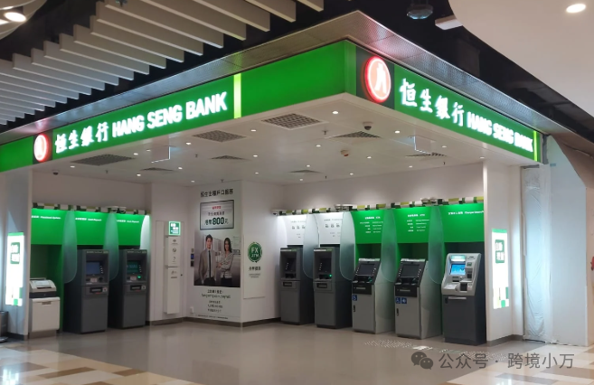
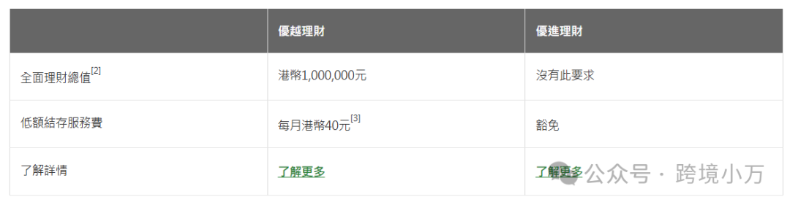
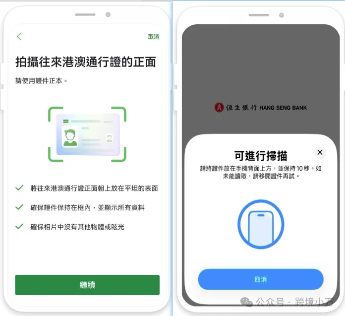
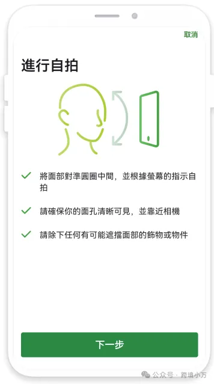
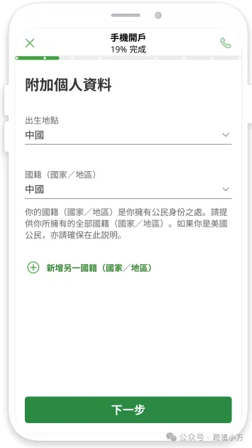
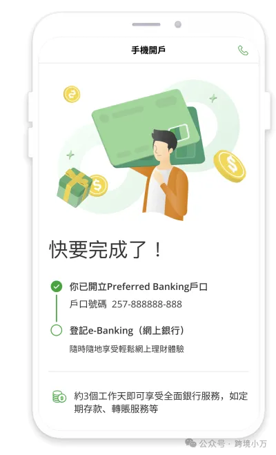

# 2026恒生银行香港开户指南：内地见证、家庭账户、恒生App开户流程

⚠️ 重要提醒：恒生银行新增APP开户申请通道，基础账号优进理财没有最低存款要求，没有管理费。

如果你计划赴港开户，建议提前确认最新开户方式、账户门槛、所需资料及预约要求，避免白跑一趟。

恒生银行成立于1933年，是香港本地代表性银行之一，现为汇丰集团成员。

恒生的网点和 ATM 覆盖广，App 体验成熟。在香港的任意地铁或者商城主要位置，都可以轻易找到像下图这样显眼的绿色标志。

恒生银行拥有全港最多的ATM机器和网点。是香港本地用户最爱的银行，有点类似于内地的招行。

## 恒生银行账户优势：

- 多币种账户：美元、港元、欧元、新加坡元、澳元、日元、英镑等市面上常见的币种全都支持。
- 转账额度大，登记账户150万港币或等值外币/日；未登记账户40万港币或等值外币/日。
- 定存利率高，通常比其他银行高0.1-0.3左右。
- 出入金港美G券商便捷，支持FPS，eDDA快捷入金。
- 支持一拖三家庭账户，只需一个账户满足优越理财要求，其余附属账号全部享受优越理财服务

## 恒生银行开户方式：

## 恒生三种开户方式对比

| 开户方式 | 是否需要去香港 | 适合人群 | 优点 | 注意事项 |
| --- | --- | --- | --- | --- |
| 内地分行见证开户 | 不需要亲自去香港 | 有优越理财需求、家庭成员一起开户的人 | 可在内地完成见证，一人达标可带直系亲属开户 | 需要先开内地恒生优越理财账户并维持资金要求 |
| 香港本地预约开户 | 需要去香港 | 能赴港、希望现场沟通的人 | 可与客户经理面对面沟通，适合资产证明较完整的用户 | 通常需要预约，内地身份多以优越理财账户为主 |
| 手机 App 自助开户 | 需要人在香港或满足系统验证条件 | 想快速尝试自助申请的人 | 流程灵活，不用排队，手机即可提交申请 | 属于系统审核，不代表更容易通过，可能不适合复杂需求 |

### **1. 恒生内地分行见证开户**

1. 目前恒生在北京、天津、上海、杭州、福州、广州、深圳有分行，可提供远程见证开户服务。
2. 需先在恒生内地分行开立优越理财账户，存入50w，至少需要保持3个月以上。
3. 分行提供远程见证开立香港的同名账户，约3-4周可拿到香港账户，需支付400-600元/位的律师见证费。
4. 主账号支持最多3位年满18周岁的直系亲属（父母、配偶、子女）开立附属账户，附属账号没有存款要求，免管理费，家庭账户之间跨境汇款无手续费，电报费。

> 如有需要，可找我这边对接的内地客户经理，无理财要求，开户还有额外积分奖励。 vx: kuajingxiaowan

### 2. **恒生香港柜台开户**（需预约）

如果直接去香港开立恒生，需要先预约才能开户。对于内地身份证用户，恒生香港柜台只接受【优越理财】账户申请。

优越理财账户有最低存款要求100万港币（需半年内存入），如达不到则会收取40 or 340HKD/月的管理费。当然后期可以申请降级为普通免管理费的账户。

**开户要求如下：**

1. 港澳通行证、身份证、过关小白条

2.  资产证明：30w（个人签） / 50w（团队签）

3. 现金3000港币或等值RMB用户账户激活

4. 支持护照开户

如需预约，可vx我：kuajingxiaowan （备注恒生开户）

## 恒生银行APP开户（2026新增）

### 3. 恒生手机 App 自助开户

除了内地见证开户和香港本地预约开户外，恒生银行现在也支持手机 App 自助开户。用户可以通过恒生香港官方 App 提交开户申请，完成身份验证、资料填写、税务信息声明和账户用途说明。

这种方式的优势是流程更灵活，不需要一开始就预约柜台；但它并不等于“零门槛开户”。对于内地居民来说，App 开户通常仍然需要本人身处香港或满足银行系统的身份验证条件，并准备好内地身份证、港澳通行证、入境记录、手机号码、地址信息及开户用途说明。

需要特别注意的是，App 开户属于系统自助审核，是否通过仍取决于身份验证、资料完整度、开户用途、入境记录和银行风控判断。资料填写不准确、用途不清晰，仍然可能被拒或要求补充资料。

整个流程和[汇丰One在线开户](../01-%E9%A6%99%E6%B8%AF-HSBC%E6%B1%87%E4%B8%B0%E9%93%B6%E8%A1%8C/01-%20HSBC%E9%A6%99%E6%B8%AF%E6%B1%87%E4%B8%B0%E9%93%B6%E8%A1%8C%E5%BC%80%E6%88%B7%E6%94%BB%E7%95%A5%202026.md)一样，大同小异。

**恒生APP开户要求：**

- 年滿18歲；
- 身处香港（需检查GPS定位）
- 持有中國內地住宅地址；
- 持有有效的往來港澳通行證
- 手机需带NFC功能
- 有效出入境记录（需持港澳通行证到港）

app开户流程如下：

**1. 下载恒生银行**

手机应用市场搜索【恒生个人流动理财服务】

安卓可以下载APK包安装：

<https://www.hangseng.com/zh-hk/e-services/personal-mobile-services/apk>

**2. 开立户口**

选择【手机开户】，开立恒生综合户口。

选择【优进理财】，没有最低存款要求，0管理费。

**3. 识别港澳通行证**

手机需支持NFC功能，将港澳通行证置于手机背面，自动识别。

**4. 人脸识别**

**5. 上传出入境记录**

按照提示，到【移民局12367】小程序下载出入境记录。

需要注意：到香港后，正常情况下，出入境记录半个小时可以下载。如遇节假日高峰期，系统可能故障，需做好备选。

**6. 个人地址信息**

此处需要填写个人的地址和背景调查信息。

地址用于接收实体卡片和后期银行的信函。该地址非常重要，请勿随意填写。

**7. 提交审核**

提交后有三种结果：

1. 当场审核通过，需要按照提示马上注册网银。

2. 审核，等后台人工审核后，再注册网银。

3.被拒绝，因资料等原因导致被拒。

## 恒生银行香港开户常见问题

### Q1：内地居民可以开恒生银行香港账户吗？

可以。内地居民可以通过内地分行见证开户、香港本地预约开户，或手机 App 自助开户等方式申请恒生香港账户。不同方式对应的账户类型、资料要求和审核标准不同。

### Q2：恒生银行现在可以手机 App 开户吗？

可以，恒生现在支持手机 App 自助开户。用户可以通过恒生香港官方 App 提交开户申请，完成身份验证、资料填写和税务信息声明。不过 App 开户仍然需要满足银行审核要求，并不代表一定通过。

### Q3：恒生 App 开户适合所有人吗？

不一定。App 开户适合资料相对简单、希望自助申请的用户。如果你希望申请优越理财账户、家庭账户，或者需要客户经理协助，内地见证开户或香港预约开户可能更适合。

### Q4：恒生内地见证开户需要多少钱？

根据页面当前信息，通常需要先在恒生内地分行开立优越理财账户，并存入 50 万人民币，至少维持 3 个月以上。具体要求以恒生银行内地分行和客户经理最新答复为准。

### Q5：恒生优越理财家庭账户是什么意思？

恒生优越理财支持“一人达标，全家可开”。主账户满足优越理财要求后，最多可支持 3 位年满 18 岁的直系亲属开立附属账户，适合家庭成员一起配置香港银行账户。

### Q6：恒生银行账户有管理费吗？

如果申请优越理财账户，需要关注最低资产要求。若未达到要求，可能产生月费。后续如不想维持高额资产，可咨询银行是否支持降级为普通账户。

### Q7：恒生适合港美股券商入金吗？

适合。恒生支持 FPS、eDDA 等常见香港本地转账方式，可用于部分港美股券商入金。具体支持情况以券商和银行实际页面为准。
