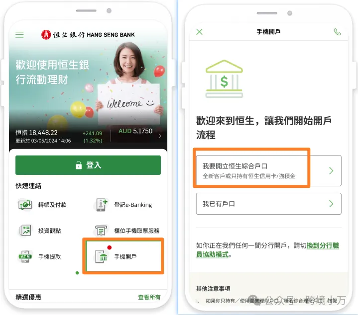
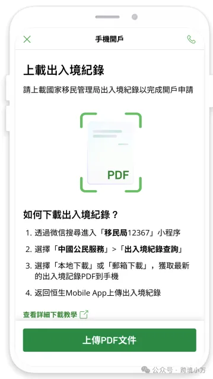

# 恒生银行香港开户指南，恒生App开户流程

恒生银行成立于1933年，是香港本地代表性银行之一，现为汇丰集团成员。

恒生的网点和 ATM 覆盖广，App 体验成熟。在香港的任意地铁或者商城主要位置，都可以轻易找到恒生银行的 ATM 机器。

## 恒生银行账户优势：

- 多币种账户：美元、港元、欧元、新加坡元、澳元、日元、英镑等市面上常见的币种全都支持。
- 转账额度大，登记账户150万港币或等值外币/日；未登记账户40万港币或等值外币/日。
- 定存利率高，通常比其他银行高0.1-0.3左右。
- 出入金港美G券商便捷，支持FPS，eDDA快捷入金。
- 支持一拖三家庭账户，只需一个账户满足优越理财要求，其余附属账号全部享受优越理财服务

## 恒生银行APP开户（2026新增）

除了内地见证开户和香港本地柜台开户外，恒生银行现在也支持手机 App 自助开户。用户可以通过恒生香港官方 App 提交开户申请。整个流程和[汇丰One在线开户](../01-%E9%A6%99%E6%B8%AF-HSBC%E6%B1%87%E4%B8%B0%E9%93%B6%E8%A1%8C/01-%20HSBC%E9%A6%99%E6%B8%AF%E6%B1%87%E4%B8%B0%E9%93%B6%E8%A1%8C%E5%BC%80%E6%88%B7%E6%94%BB%E7%95%A5%202026.md)一样，大同小异。

**恒生APP开户要求：**

- 年滿18歲；
- 身处香港（需检查GPS定位）
- 持有中國內地住宅地址；
- 持有有效的往來港澳通行證
- 手机需带NFC功能
- 有效出入境记录（需持港澳通行证到港）

app开户流程如下：

**1. 下载恒生银行**

手机应用市场搜索【恒生个人流动理财服务】

安卓可以下载APK包安装：

<https://www.hangseng.com/zh-hk/e-services/personal-mobile-services/apk>

**2. 开立户口**

选择【手机开户】，开立恒生综合户口。

选择【优进理财】，没有最低存款要求，0管理费。

**3. 识别港澳通行证**

手机需支持NFC功能，将港澳通行证置于手机背面，自动识别。

**4. 人脸识别**

**5. 上传出入境记录**

按照提示，到【移民局12367】小程序下载出入境记录。

需要注意：到香港后，正常情况下，出入境记录半个小时可以下载。如遇节假日高峰期，系统可能故障，需做好备选。

**6. 个人地址信息**

此处需要填写个人的地址和背景调查信息。

地址用于接收实体卡片和后期银行的信函。该地址非常重要，请勿随意填写。

**7. 提交审核**

提交后有三种结果：

1. 当场审核通过，需要按照提示马上注册网银。

2. 审核，等后台人工审核后，再注册网银。
3. 被拒绝，因资料等原因导致被拒。
