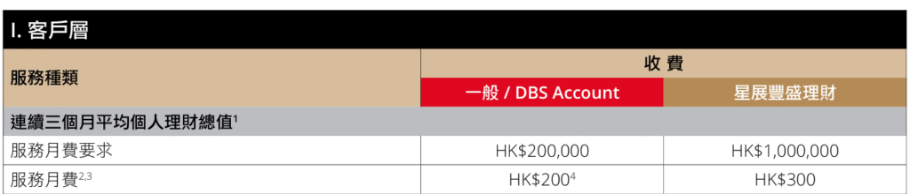

# DBS星展银行开户2026｜香港/新加坡账户内地见证要求

对于内地居民来说，目前只能申请 DBS 的 Treasures 丰盛理财 VIP 账户，这个账户的资金门槛是 100 万 RMB。

## DBS星展银行介绍

DBS星展银行成立于1968年，前身为新加坡发展银行（Development Bank of Singapore）。DBS背后的股东是新加坡国家主权财富基金-淡马锡，DBS相当于新加坡的国有银行。

DBS星展银行有很多响亮的名号，’新加坡最大银行“，“全球最佳数字银行”，“亚洲最安全银行”等等title。

对于内地居民来说，DBS账户的好处主要是以下几点：

- 无外汇管制，资金进出自由，同名账户转账免手续费，即时到账。
- 不同于香港的司法体系，账户资金隔离性好。
- 中文服务，App用户体验好
- 账户稳定性高，不易冻卡，资金安全有保障。

## **DBS开户要求和门槛**

内地居民如需申请DBS香港账户或者新加坡账户，只能开丰盛理财高级账户（DBS Treasures）。丰盛理财账户有最低存款要求，具体如下：

| 地区 | 账户类型 | 参考门槛 |
| --- | --- | --- |
| DBS中国内地 | 丰盛理财 | 100万人民币 |
| DBS香港 | Treasures 丰盛理财 | 100万港币 |
| DBS新加坡 | Treasures 丰盛理财 | 35万新币，约190万人民币以上 |

个人可同时开立了多个DBS账户，只需要其中任意一个账号满足最低存款要求，即可豁免所有账户的管理费。

以香港账户为例：如资金不足100万港币，则会被收取300港币/月的管理费。就算降级为普通账户，也有最低20w的存款要求， 否则会收取200港币/月的管理费。

### DBS开户有哪几种方式？

- **内地分行见证开户（丰盛理财）**：目前DBS在北上广深杭五个一线城市有网点，可以支持远程见证开立DBS香港或新加坡的账户。前提是需要先开通DBS中国的账户，并存入100w人民币，才能远程见证开立境外账户服务。
  1. 开立内地DBS账户，存入100w，至少需要保持3个月
  2. 远程见证开立香港或者新加坡账户，会收取一个500左右的律师见证费。
- **香港柜台预约开户（丰盛理财）**：DBS香港支持内地身份证用户开户，预约，并携带以下资料按时到现场开户。
  1. KYC证件：身份证、港澳通行证或者护照、过关小票
  2. 50w资产证明（定存、活期存款等）
  3. App当场可用，卡片会邮寄到你填写的开户地址

有需要可以找我（vx：hkxiaowan）预约DBS 的开户时间，专属客户经理直接对接，不用买理财。
