# 香港汇丰银行 App 使用指南：红狮子/蓝狮子区别、扣账卡申请、转账与支付宝绑定

很多人开通香港汇丰账户后，会搞不清楚红狮子、蓝狮子、扣账卡、提款卡和 App 之间的关系。简单来说，**账户是核心，卡只是账户的附属工具**。即使暂时没有实体卡，也不影响你登录汇丰 App、查看账户、接收转账、绑定证券账户或进行部分线上操作。

这篇文章会用最直白的方式，帮你理清：汇丰红狮子和蓝狮子有什么区别、蓝狮子万事达扣账卡怎么申请和激活、内地如何转账到香港汇丰、汇丰如何转账给其他香港银行，以及绑定支付宝和用卡安全要注意什么。

## 文章目录：

- [汇丰银行户口和卡的关系](01-项目库/06-%20go-global/01-%20境外银行账户/香港-HSBC汇丰银行/hsbc-guide/index.md#hsbc汇丰银行户口和卡的关系)
- [汇丰户口号码和汇款信息](01-项目库/06-%20go-global/01-%20境外银行账户/香港-HSBC汇丰银行/hsbc-guide/index.md#汇丰户口号码和汇款信息)
- [汇丰提款卡和扣账卡有什么区别？红狮子和蓝狮子怎么选？](01-项目库/06-%20go-global/01-%20境外银行账户/香港-HSBC汇丰银行/hsbc-guide/index.md#mastercard)
- [汇丰蓝狮子万事达扣账卡申请和激活](01-项目库/06-%20go-global/01-%20境外银行账户/香港-HSBC汇丰银行/hsbc-guide/index.md#汇丰蓝狮子万事达扣账卡)
- [内地怎么转账到香港汇丰？](01-项目库/06-%20go-global/01-%20境外银行账户/香港-HSBC汇丰银行/hsbc-guide/index.md#z)
- [汇丰怎么转账给其他银行？](01-项目库/06-%20go-global/01-%20境外银行账户/香港-HSBC汇丰银行/hsbc-guide/index.md#汇丰)
- [为什么汇丰 App 里不能直接转账？先检查转账限额](01-项目库/06-%20go-global/01-%20境外银行账户/香港-HSBC汇丰银行/hsbc-guide/index.md#为什么汇丰-app-里不能直接转账？先检查转账限额)
- [汇丰蓝狮子绑定支付宝](01-项目库/06-%20go-global/01-%20境外银行账户/香港-HSBC汇丰银行/hsbc-guide/index.md#汇丰蓝狮子绑定支付宝)
- [万事达卡注意事项](01-项目库/06-%20go-global/01-%20境外银行账户/香港-HSBC汇丰银行/hsbc-guide/index.md#万事达卡注意事项)
- [香港汇丰 App 使用常见问题 FAQ](01-项目库/06-%20go-global/01-%20境外银行账户/香港-HSBC汇丰银行/hsbc-guide/index.md#香港汇丰-app-使用常见问题-faq)

## 汇丰银行户口和卡的关系

香港的银行账户和卡是两个概念，我们经常说的去香港开户，实际上是指开立银行账户（如汇丰的One综合理财账户、卓越理财账户）。

卡是银行账户的附属功能，一个银行账户可以申请多个卡，如提款卡（红狮子）、扣账卡（蓝狮子）、信用卡等。

有了账户后，就可以登录网银APP，大部分功能都可以在网银APP上完成，如ATM机存取款、绑定证券账户入金、在线转账等大部分操作。没有卡并不影响账户使用。

汇丰账户账户支持12个币种的货币，港币是基础货币，另外还支持美元、欧元、英镑、新币、泰铢等多种货币。所有货币可以在账户内任意兑换，没有外汇管制。

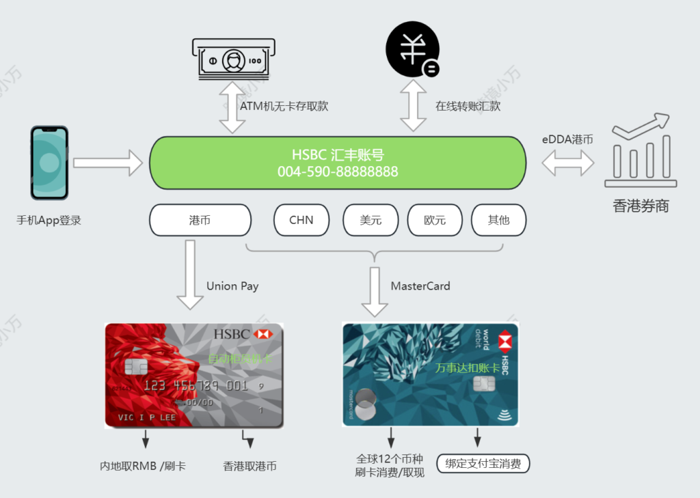

## 汇丰户口号码和汇款信息

汇丰账户通常由12位数字组成，前面3位是分行号码，后面9位为账户号码，其中账户号码的最后三位代表账户类型，833表示普通的综合理财账户，888则为卓越综合理财账户类型。

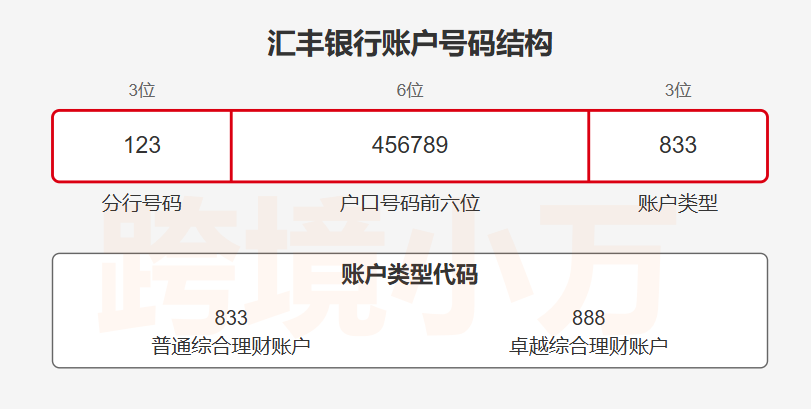

香港境内汇款到汇丰时需要填入的信息：

- RTGS代码（香港银行间汇款代码）：**004**
- SWIFT代码（跨境汇款代码）：**HSBCHKHHHKH**

## 汇丰提款卡和扣账卡有什么区别？红狮子和蓝狮子怎么选？

很多人开通香港汇丰账户后，会搞不清楚提款卡、扣账卡、红狮子和蓝狮子的区别。简单来说，**提款卡主要用于 ATM 取现和存款，扣账卡主要用于日常消费和线上支付**。如果你只是想管理账户、取现或存款，提款卡已经够用；如果你希望绑定 Apple Pay、支付宝、微信支付，或者进行线上消费，蓝狮子扣账卡会更方便。

| 对比项目 | 提款卡 （ATM 取现 / 存款） | 扣账卡 （主要用于消费） |
| --- | --- | --- |
| **发卡组织** | 银联 | Mastercard 万事达 |
| **获取方式** | 新开户默认包含，EMS 邮寄，无年费 | 需要在汇丰 App 上自行申请，首次免费邮寄，无年费 |
| **对应账户** | 港币账户 | 支持 12 个币种 |
| **消费扣款方式** | 国内人民币消费时，从港币账户扣款，并自动换汇成港币 | 优先从对应货币账户扣款。例如美元消费优先从美元账户扣款； 如果对应币种余额不足，则从港币账户自动换汇扣款 |
| **取现人民币** | 汇丰 ATM：20 港币 + 1% 手续费 银联 ATM：50 港币手续费 | 汇丰 ATM 免费，每次最多 4,000 港币，每天最多 20,000 港币 其他 Mastercard 机器：每次 40 港币手续费 |
| **支付平台绑定** | 仅支持 Apple Pay | 支持 Apple Pay、微信支付、支付宝等。 一般消费 200 港币以下免手续费，200 港币以上可能收取约 3% 手续费，具体以平台和银行规则为准 |
| **其他福利** | 暂无明显消费返现 | 部分消费场景可能有约 0.4% 消费返现，具体以汇丰当期活动为准 |

### 小万提醒

- 提款卡和扣账卡都是账户的附属卡，使用的是汇丰账户里的余额，不需要额外充值。
- 万事达扣账卡是借记卡，不是信用卡。消费时直接从账户余额中扣款。
- 内地居民不能直接申请内地发行的汇丰万事达扣账卡，这里讨论的是香港汇丰账户下的扣账卡。
- 如果你主要用于 ATM 取现、存款，提款卡就可以满足基本需求；如果你想绑定支付宝、微信支付、Apple Pay 或进行海外线上消费，建议申请蓝狮子扣账卡。

一句话：能用蓝狮子，尽量用蓝狮子。

## **汇丰蓝狮子万事达扣账卡**申请和激活

蓝狮子卡需要在户口开通后，单独在App上申请，免费，没有年费，默认发EMS邮政快递，每人最多可以申请6张附卡。

**汇丰蓝狮子申请方式如下：**

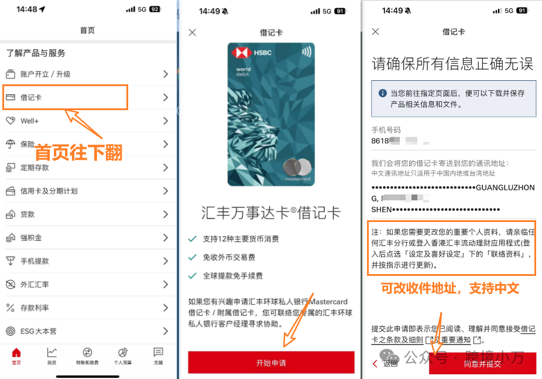

收到卡片后，汇丰蓝狮子需先在App上激活并电话给汇丰（00852-31630633）设置密码才能使用，密码需单独设置，并非One账号的取现密码。

## 内地怎么转账到香港汇丰？

两种方式可以从内地汇款到香港：

1. 跨境支付通：适合1w以内，秒到账，0费用。具体参考：[跨境支付通](01-项目库/06-%20go-global/repo/content/tools/zft/index.md)
2. 传统跨境汇款：适合大额汇款，最高支持5w美金汇款至香港账户，具体需看个人在银行的转账限额。

传统跨境汇款的主要步骤：

### 1. 先购汇

目前内地无法直接转RMB到境外，必须先购汇成港币或者美金等外币，每人每年的购汇额度是5万美金或等值外币。

步骤如下：

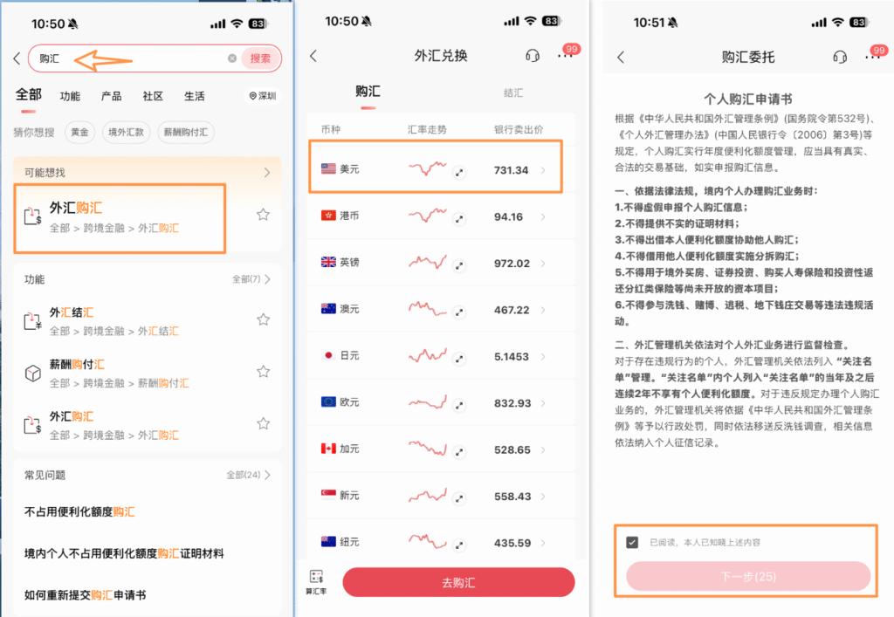
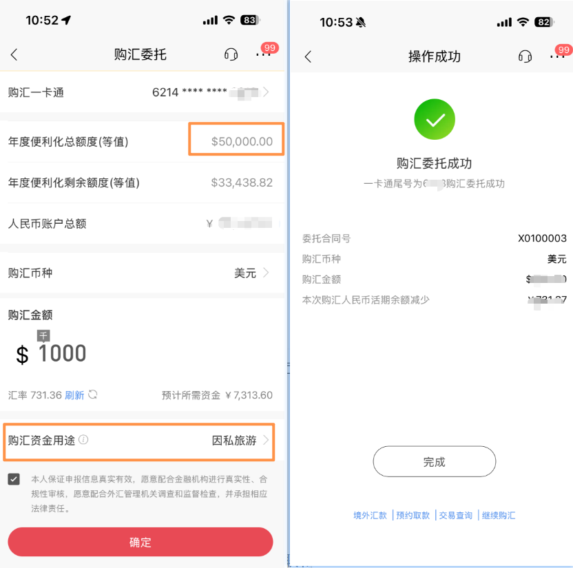

### 2. 跨境汇款

大部分银行都支持跨境汇款功能。

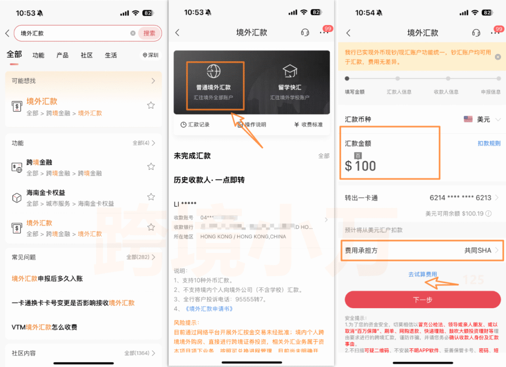

**重点信息：**

- 收款人地址：尽量填香港的地址，需精确到门牌号，可通过酒店预定App找到任意一个酒店的地址即可
- 收款银行信息：RTGS是香港银行之间转账的代码，汇丰是004，中银香港是012，输入这个代码后招行App会自动填充后面的swift等信息。
- 汇款用途和附言：私人旅游，附言就填: travel and shopping.

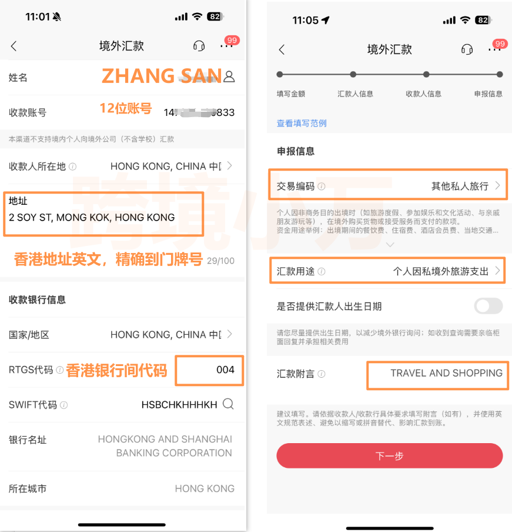

后面就是信息确认了。

转账费用： 根据转账金额不同而不同，有的银行可以减免，如中银内地和香港之间。

到账时间：如后台审核通过，工作日一般当天或者第二天可到，节假日顺延。

## 汇丰怎么转账给其他银行？

需特别注意：汇丰默认转账额度是0，需先添加受款人，为每个受款人单独设置额度后，才能转账，步骤如下：

1、先添加受款人信息

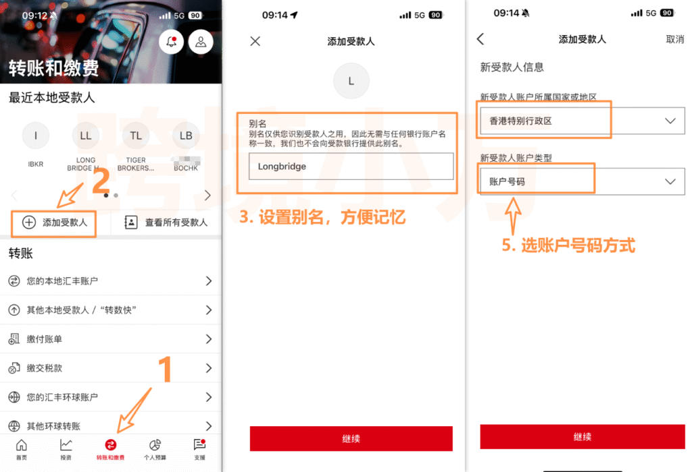
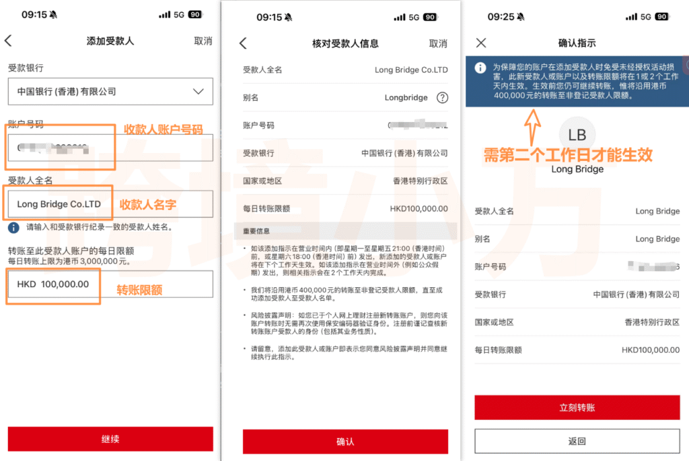

2、等待收款人信息添加确认后再转账

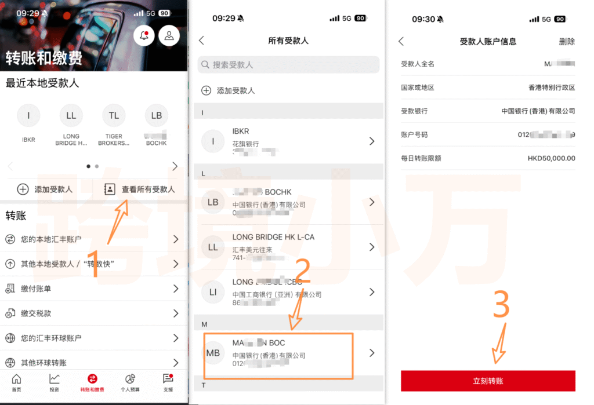
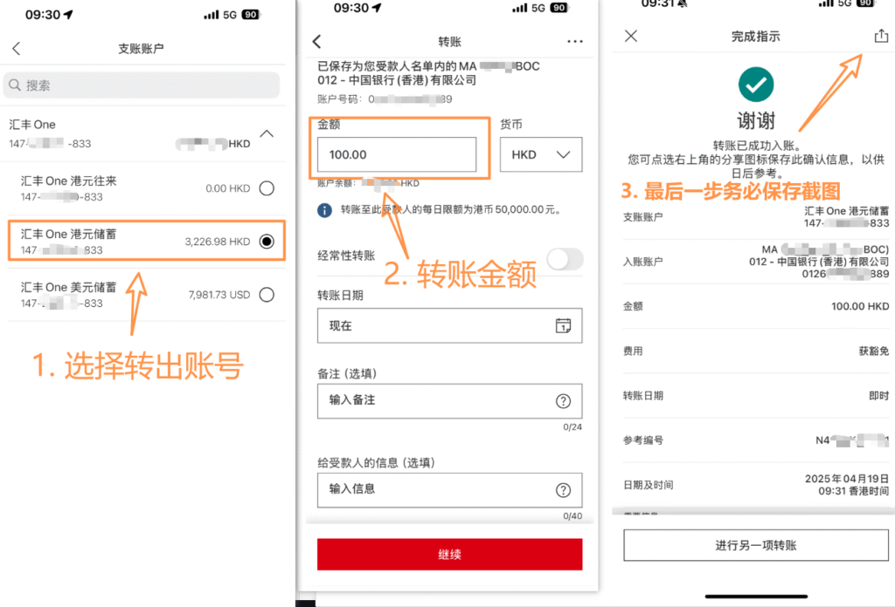

最后一步务必保存截图，不然要找到你的转账记录会非常麻烦。

## 为什么汇丰 App 里不能直接转账？先检查转账限额

很多新开户用户第一次使用汇丰 App 转账时，会发现明明账户里有钱，但就是转不出去。常见原因不是账户异常，而是**转账限额还没有设置**。

汇丰对转账安全控制比较严格，尤其是转给非本人、非已登记收款人的账户时，通常需要先添加受款人，并为不同转账类型设置对应限额。建议你在转账前先检查：

- 是否已经启用 Mobile Security Key；
- 是否已经添加受款人；
- 是否已经设置每日转账限额；
- 是否区分了已登记受款人和非登记受款人；
- 是否超过了 FPS 或普通转账的每日限额。

如果你只是刚刚开通账户，建议先完成 App 登录、安全认证、限额设置和小额测试转账，再进行大额资金安排。

## 汇丰蓝狮子绑定支付宝

内地支付宝可以直接绑定蓝狮子卡，支持商户消费和刷卡，但不能用于个人转账。

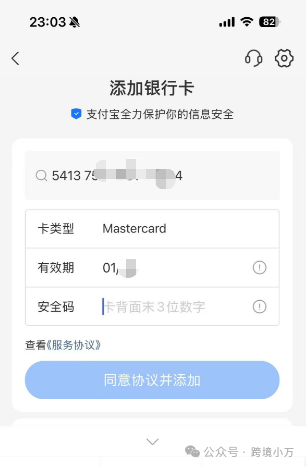

第一次绑定时，会提示需要在汇丰的App上进行一次授权操作，后续就不再需要。

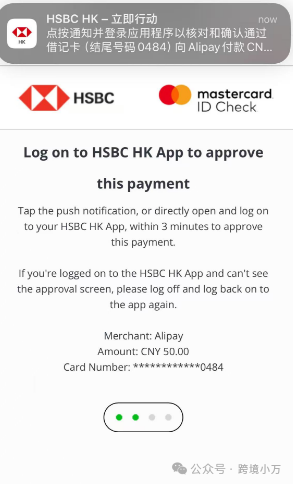

**刷卡消费限制如下：**单笔200以内免手续费

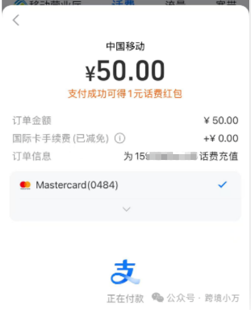

2. 超过200元的消费，每笔需收取3%的手续费。

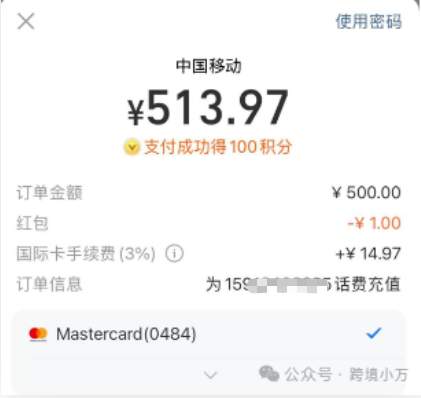

## 万事达卡注意事项

### 安全提醒：蓝狮子激活后，建议先调整每日消费限额

万事达扣账卡和内地银行卡不太一样，很多海外网站消费时只需要卡号、有效期和 CVV 码，不一定会有短信验证码或支付密码。因此，蓝狮子激活后，建议第一时间在汇丰 App 中设置一个你能接受的每日消费限额。

平时不用时，可以把限额调低；真正需要大额消费时，再临时调高。这样即使卡片信息不小心泄露，也能降低损失风险。

境外购物和消费时，尤其是网络消费时，通常只需要输入卡号，有效期和CVV码，没有国内的手机验证和密码这一说。

理论上任何人只要拿到你的卡号，有效期和CVV码就可以购物消费。遇到网站信息泄露，也就很容易造成盗刷的情况，因此千万注意，不要随便找不知名网站上输入卡的信息，不要截图或者明文记录这几个信息，以防信息泄露。

另外一个安全措施就是设置一个每日限额，截图如下：

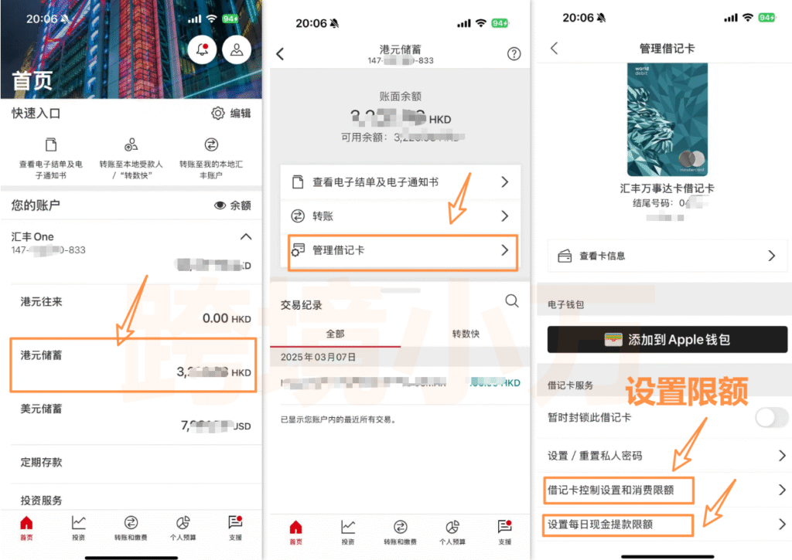

## 香港汇丰 App 使用常见问题 FAQ

### 汇丰账户开通后，没有实体卡可以使用吗？

可以。香港银行账户和银行卡不是一回事。账户开通后，即使暂时没有实体卡，也可以登录汇丰 App 查看账户、接收转账、进行部分线上操作，以及绑定证券账户入金。实体卡主要用于 ATM 取款、线下刷卡和部分线上消费场景。

### 汇丰红狮子和蓝狮子有什么区别？

简单理解，红狮子更偏向传统提款卡，主要用于 ATM 取款和基础银行操作；蓝狮子是 Mastercard 万事达扣账卡，更适合线上消费、线下刷卡、海外支付以及绑定支付宝等场景。日常消费场景下，通常优先使用蓝狮子。

### 汇丰蓝狮子万事达扣账卡需要单独申请吗？

需要。蓝狮子扣账卡通常需要在汇丰 App 内单独申请。申请成功后，卡片会邮寄到你填写的地址。收到卡片后，还需要按要求完成激活和密码设置。

### 内地可以直接转人民币到香港汇丰吗？

通常不可以直接把人民币作为普通跨境汇款转到香港个人账户。一般需要先在内地银行购汇成港币、美元等外币，再通过传统跨境汇款或其他合规方式转入香港账户。具体额度、费用和审核要求，以实际办理银行为准。

### 汇丰 App 转账为什么提示额度不足或无法转账？

常见原因是每日转账限额没有设置、受款人还没有添加成功、Mobile Security Key 未启用，或者转账类型对应的限额不足。建议先在汇丰 App 或网上银行中检查每日支付及转账限额，再进行小额测试。

### 汇丰蓝狮子可以绑定支付宝吗？

一般情况下，汇丰蓝狮子万事达扣账卡可以绑定内地支付宝用于部分商户消费，但通常不能用于个人转账。实际是否支持、手续费和限额，以支付宝及汇丰当时规则为准。

### 蓝狮子万事达扣账卡安全吗？

蓝狮子本身是正规扣账卡，但海外卡消费逻辑和内地银行卡不同。部分网站只需要卡号、有效期和 CVV 码即可完成支付，因此不建议在不熟悉的网站随意输入卡片信息。激活后建议尽快设置每日消费限额。

好了，如有其他任何疑问，可加我微信：hkxiaowan

更多汇丰和其他香港银行卡内容可参考：

[2025中银香港开户攻略，线上+线下开户流程详解，附避坑指南](内地居民%20HSBC香港汇丰银行开户攻略%202026.md)

[2025年最新HSBC香港汇丰银行开户全流程，0费用，附开户问题FAQ](内地居民%20HSBC香港汇丰银行开户攻略%202026.md)
