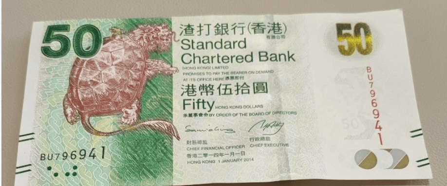
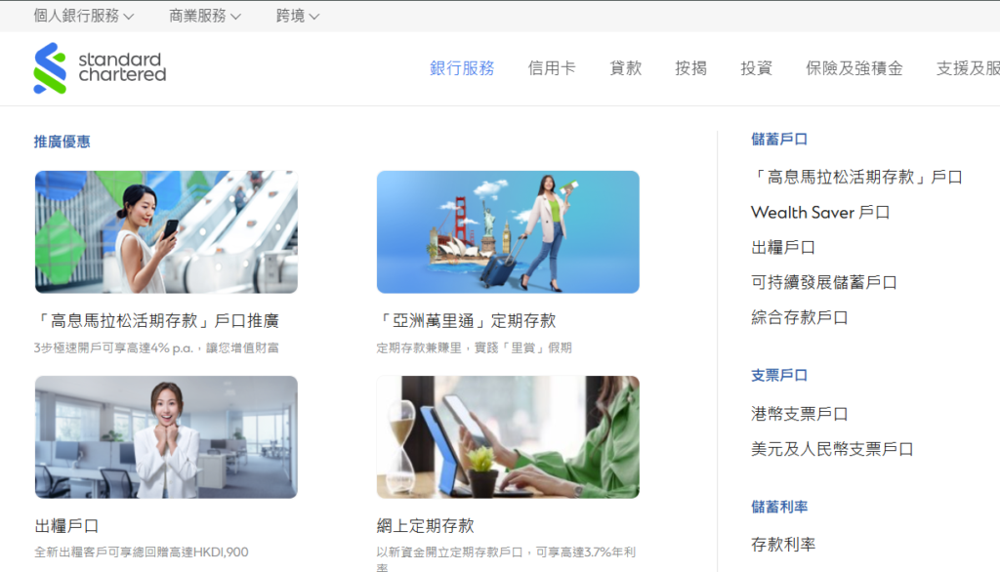
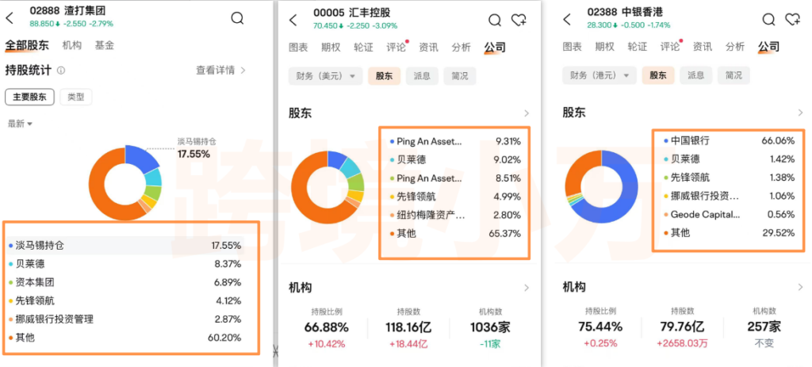
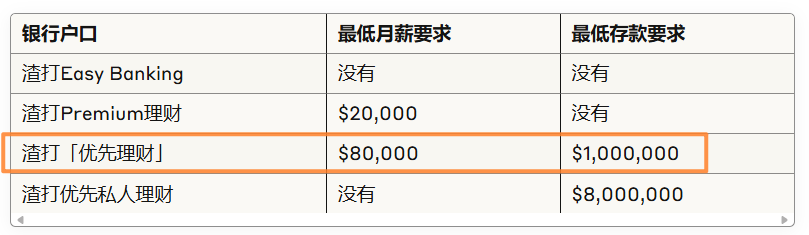
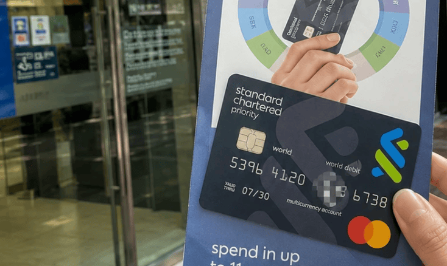
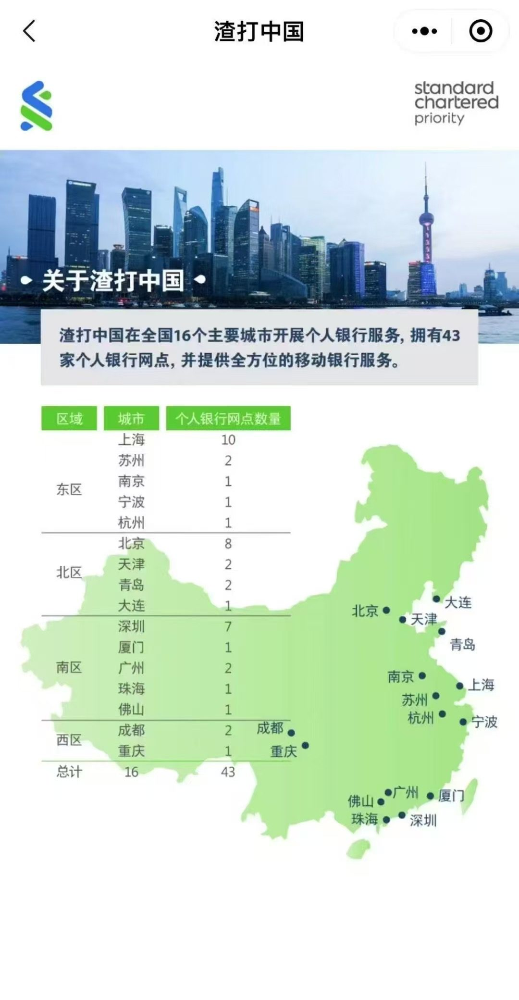
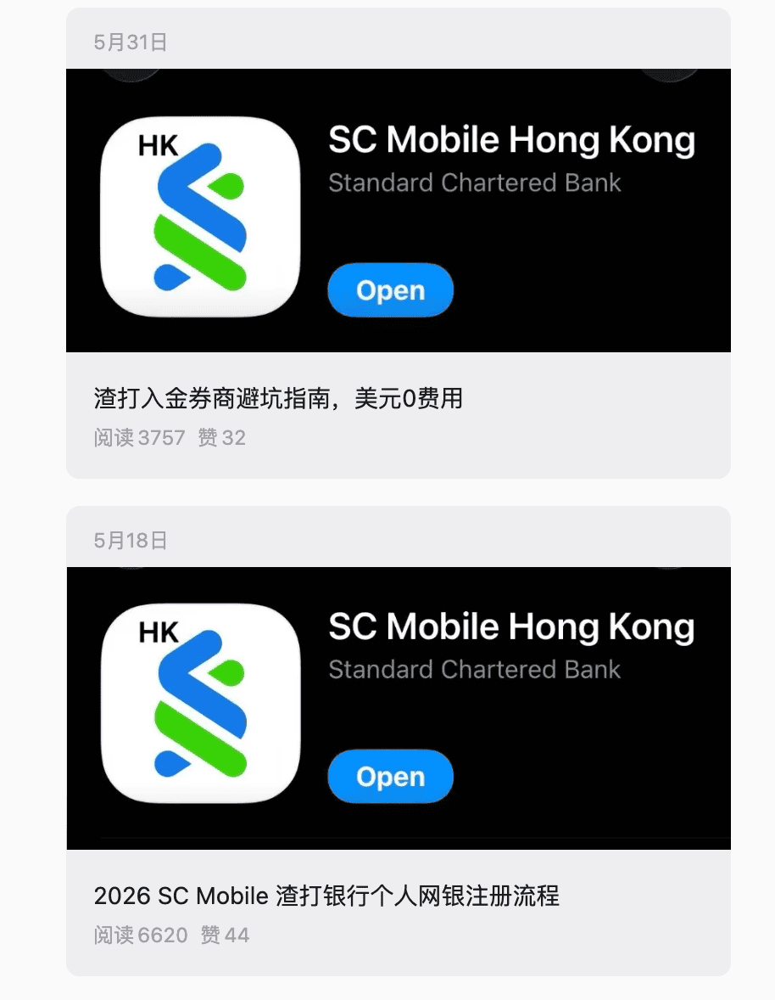

# 2026 渣打香港开户指南：内地居民开户条件、优先理财与内地见证流程

渣打银行和汇丰、中银香港一起，是港币的三大发钞行。我们拿到的港币都是由这三家银行印制的。

但跟另外两家比起来，渣打在内地的存在感好像没那么强，很多人对它的开户政策也不太熟悉。一个最主要的原因是，对于内地用户来说，渣打银行的开户门槛是这三家里面最高的。

因为目前内地居民只能申请渣打银行的 **渣打优先理财 Priority Banking** VIP 账户。优先理财账户需要满足最低存款要求，渣打中国优先理财最低要求 50 万 RMB，渣打香港优先理财则为 100 万港币。

这篇文章，我会把渣打香港适合什么人、开户条件、两种办理方式、账户管理费，以及实际使用中的注意事项，一次讲清楚。

## 一、渣打香港适合哪些人？

渣打并不是一张适合所有人的低门槛港卡。如果你只是想开一个香港账户，用来储蓄、港美股入金或者日常转账，[汇丰 One](内地居民%20HSBC香港汇丰银行开户攻略%202026.md)、[中银香港](01-项目库/06-%20go-global/01-%20境外银行账户/香港-BOCHK中银香港/index.md) 、[众安银行](01-项目库/06-%20go-global/01-%20境外银行账户/香港-ZA%20众安银行/index.md) 等账户通常更容易入门。

但如果你有下面这些需求，渣打会更值得考虑：

- 有大额海外资产配置，如储蓄、投资、移民等；
- 拥有海外身份税号，希望用中国护照+海外税号开户，或者第二护照身份进行开户；
- 不出境开立香港、新加坡、迪拜、马来西亚等地账户。

因此，相比单纯把它当成一张“港卡”，我更倾向于把渣打看成一个**面向中高净值客户的跨境资金和财富管理账户**。

## 二、为什么高净值客户会选择渣打香港？

香港有很多银行，为什么高净值用户会更偏爱渣打银行账户？

渣打**是一家纯粹的外资银行**，相比于汇丰和中银，渣打账户具有更高的隐私性和稳定性。

这主要来源于渣打的相对独立性，其中第一大股东是新加坡国家主权财富基金淡马锡。汇丰的第一大股东是平安，中银香港的第一大股东是内地的中国银行。

换句话说，渣打是所有香港银行里面受内地影响最小的银行。

## 三、渣打香港账户类型和优先理财要求

渣打香港有不同账户等级，但对于内地居民来说，目前只能申请它的优先理财账户。

按照目前的开户政策，优先理财账户需要维持 100 万港币或等值资产。

开户后的前六个月，账户管理费可以豁免。六个月之后，如果账户资产不足 100 万港币，会被收取每季度 900 港币左右的账户管理费。

当然，如果你开通完优先理财后，后续不想继续维持优先理财，可以拨打渣打客服电话，申请降级为普通Easy Banking 账户（豁免管理费）。Easy Banking账户功能和优先理财一样，只是没有专属的客户经理服务支持。

## 四、渣打香港的两种开户方式

目前，内地居民开立渣打香港账户，常见的方式主要有以下两种：

### 1. 香港分行预约开户

第一种方式，是本人前往香港，通过预约到渣打私行中心办理优先理财账户。

这种方式的优点是速度相对快，开户成功后通常可以现场拿到银行卡，同时会有专属客户经理协助完成开户和后续维护。

**你需要准备以下材料：**

- 中国内地身份证和大于3个月有效期的港澳通行证
- 开户人名下50万RMB 资产证明（无需冻结，活期、理财、股票均可，需要当场核验）
- 10000港币或等值外币现金，用于账户开通过后激活使用，需当场存入。

**需要注意：**

- 账户开通后的 6 个月内，需要满足 100 万港币或等值资产的长期余额要求。
- 前半年豁免管理费，后期如果不达标，会被收取 900 港币/季度的管理费。
- 可电话申请降级为普通免管理费账户 Easy Banking。

### 2. 内地分行见证开海外账户（不用到香港）

如果暂时不方便去香港，可以考虑通过渣打中国远程见证，开香港渣打或者新加坡渣打等地账户。

这种方式的基本流程是：

1. 本人持身份证按预约时间前往渣打内地分行，先开立渣打中国账户；
2. 向内地账户存入 50 万人民币或等值外币，达到渣打中国优先理财的要求；
3. 准备护照或港澳通行证，在客户经理协助下申请海外账户，办理周期约 3-4 周；
4. 完成律师见证和开户资料审核；律师见证通常会产生大约 500 至 800 元人民币的费用，具体金额以实际办理时为准。
5. 等待香港账户开通和银行卡邮寄，时间约 3-4 周。

目前，渣打中国在北京、上海、深圳、广州、杭州、南京、苏州、宁波、厦门、珠海、佛山、青岛、天津、大连、重庆、成都等城市有分行。不同城市和网点的业务熟悉程度可能不一样，预约前最好先确认该网点是否可以办理海外账户见证。

注意事项：

1. 内地账户通常需要维持 50 万人民币至少三个月。前六个月可以豁免管理费，之后如果资产不足，可能会收取每月 150 元人民币左右的账户管理费。
2. 后续如果不再需要优先理财，可以将内地账户降级为普通账户。
3. 最好找熟悉海外见证开户业务的客户经理，不同网点、不同客户经理的熟悉程度不同，如果客户经理没有实际经验，资料往返和沟通时间可能会比较长。

## 五、渣打香港账户的常见问题

1. **资产门槛是硬成本**，如果长期不能维持 100 万港币或等值资产，就要考虑账户管理费或者降级为普通账户。
2. 渣打美金转账不友好，需要在网页中操作，另外美元转账可能产生每笔约 22 美元的费用。
3. 渣打 App 的使用体验并不一定适合所有人。部分用户会觉得界面和操作逻辑不如其他香港银行直观。

我们写了很多的实操使用教程，具体可以参考公众号（跨境小万）相关文章：

## 渣打VIP开户预约服务

- 香港渣打私行中心 VIP 预约
- 内地见证开户免费对接专业客户经理

hkxiaowan
