# 2026 复星证券开户指南｜星财富 App 港美股终生免佣｜美债 0 费用｜内地身份可申请

复星证券是复星集团在香港的全资子公司，受香港SFC证监会监管，支持港美股和美债等资产交易。
522 新政后，**复星证券是仅存的几个支持内地身份证申请的港美股券商。
最新的开户要求：

1. **注册时网络出口 IP 必须为香港或海外**
2. 需**完成港卡 EDDA 绑定或者存入1 万港币才能开户**

[查看复星证券最新开户奖励](https://h5.fotechwealth.com/pages/startAccount.html?channel=030006&aeCode=B2&invitationCode=RG2A9K&langType=zhCn)

邀请码：**RG2A9K**

## 快速了解复星证券

| 品牌名称  | 复星证券（App 名称：星财富 / Fosun Wealth）                                                         |
| ----- | --------------------------------------------------------------------------------------- |
| 香港主体  | 复星国际证券有限公司，复星国际（0656.HK）在港全资控股子公司。 复星国际，2025 年中国民营企业 500 强第 36 位。                       |
| 监管机构  | 香港证券及期货事务监察委员会（SFC）                                                                     |
| 牌照类别  | 第 1、2、4、6、9 类受规管活动牌照，编号：[AAF432](https://apps.sfc.hk/publicregWeb/corp/AAF432/licences) |
| 开户方式  | 星财富 App / H5 在线开户（CA 见证开户）                                                              |
| 支持市场  | 港股、美股、A 股（沪深港通）、美债、美股期权、基金、虚拟资产                                                         |
| 投资者保障 | 香港投资者赔偿基金（ICF），单个账户最高 HK$500,000                                                        |
| 主要特点  | 内地身份证可申请、港美股及美股期权终生免佣、美债 0 费用、余额自动理财                                                    |

[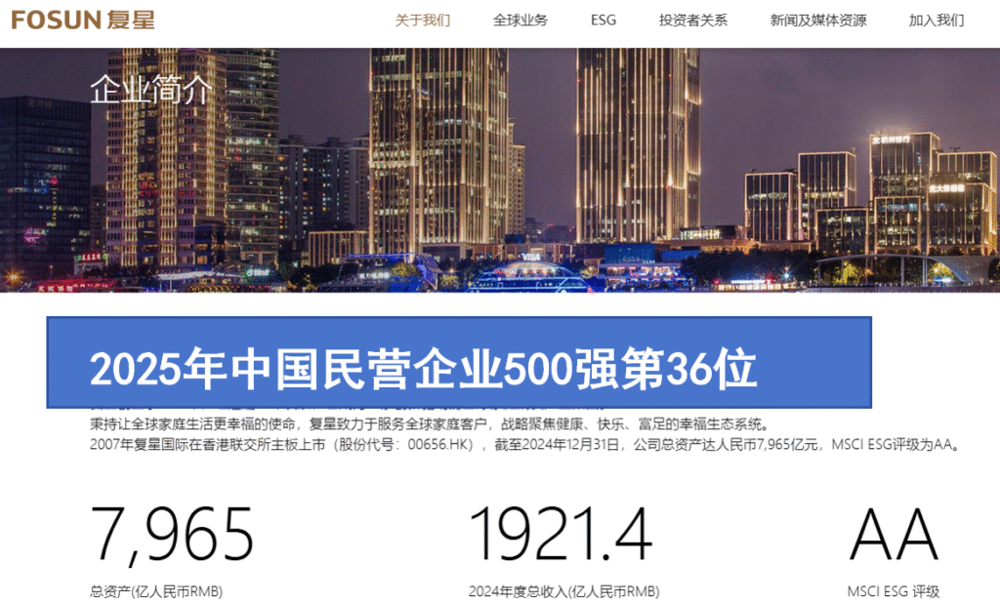](https://www.fosun.com/)

复星证券香港证监会的牌照信息：<https://apps.sfc.hk/publicregWeb/corp/AAF432/details>

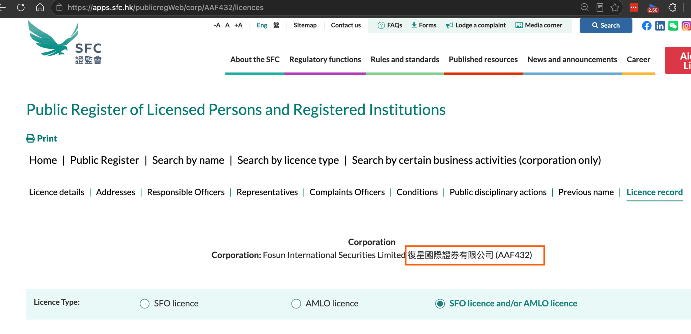

## 复星证券交易费用

复星证券港股、美股及美股期权免收券商佣金，仅收取平台费；

| 交易产品 | 佣金    | 平台费                            | 说明                 |
| ---- | ----- | ------------------------------ | ------------------ |
| 港股   | **0** | **平台费 HK$15 / 笔**              |                    |
| 美股   | **0** | **平台费 US$0.005 / 股 最低 US$1.0** | 单笔200 股以上才会超过 1 美元 |
| 美股期权 | **0** | **平台费 US$0.65 / 张**            |                    |
| 美债   | **0** | **0 平台费**                      | **美债 0 费用**        |

复星证券的交易费用是目前所有能开的券商中交易费用最低的券商之一.

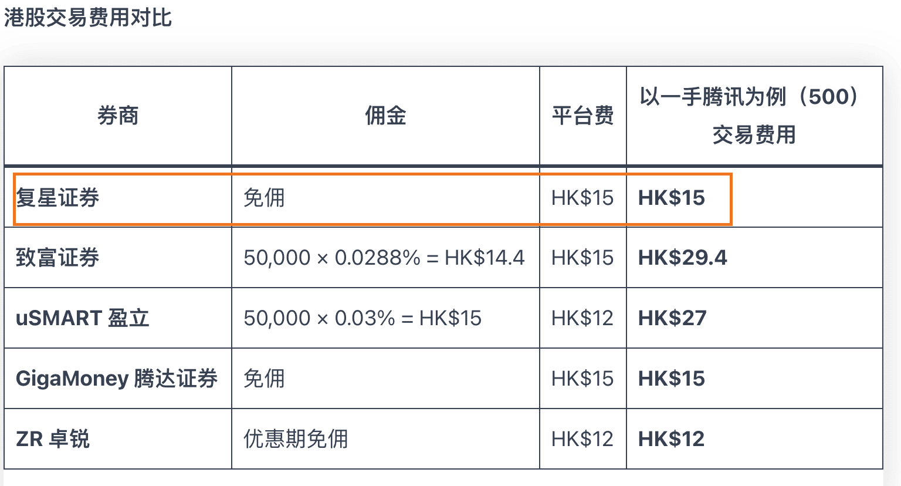

美股交易费用对比：

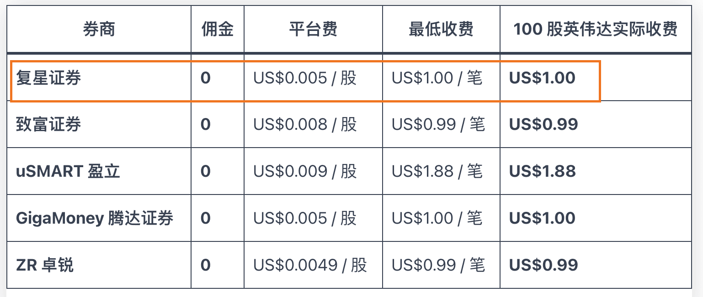

具体可参考：

[香港券商交易费对比](../broker-fees/%E6%B8%AF%E7%BE%8E%E8%82%A1%E5%88%B8%E5%95%86%E8%B4%B9%E7%94%A8%E5%AF%B9%E6%AF%94.md)

## 复星证券最新开户奖励

通过指定邀请链接注册，或 APP 开户时填写邀请码 （RG2A9K）可获得如下新用户奖励：

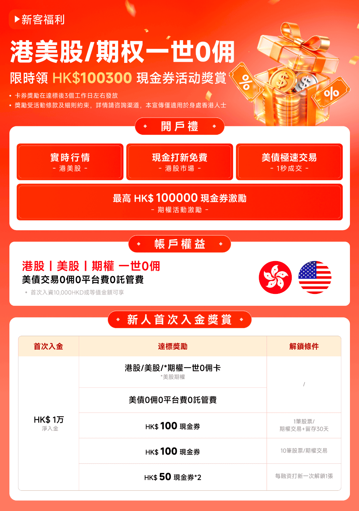

- 港美股终生免佣资格
- 美债交易 0 费用
- 200 港币现金券，购买股票时可冲抵现金使用
- 100 港币打新现金券

[查看复星证券最新开户奖励](https://h5.fotechwealth.com/pages/startAccount.html?channel=030006&aeCode=B2&invitationCode=RG2A9K&langType=zhCn)

## 复星证券开户最新要求

- 身份证
- 内地银行卡（仅用于身份验证）
- 香港或境外银行卡（出入金）
- 注册时需要IP地址为香港或海外（非中国内地IP）
- EDDA 授权，或者1 万港币入金才能激活账户

## 复星证券开户流程

以下为复星证券的开户邀请链接：

[https://h5.fotechwealth.com/pages/startAccount.html?channel=030006&aeCode=B2&invitationCode=RG2A9K&langType=zhCn](https://h5.fotechwealth.com/pages/startAccount.html?channel=030007&aeCode=B2&invitationCode=RG2A9K&langType=zhCn)

APP开户邀请注册方式如下（邀请码：**RG2A9K**）：

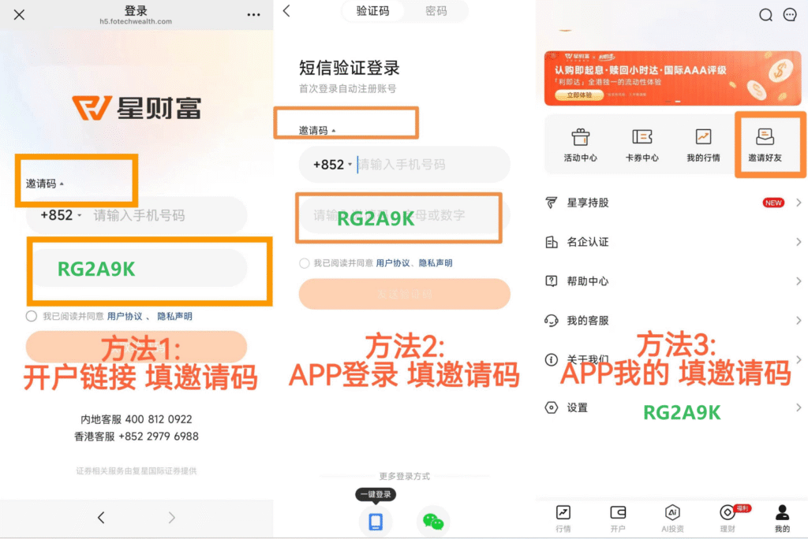

用手机登录后，选择【CA见证开户】，请务必确保开户时身处香港网络，否则无法继续。

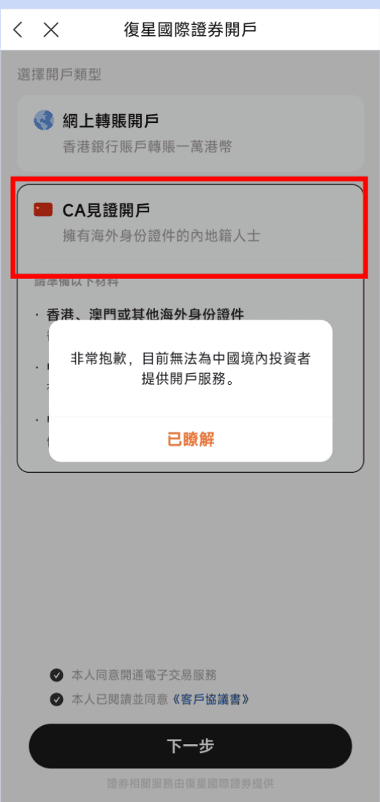

按照提示完成内地身份证和内地银行卡验证身份。内地银行卡仅作为身份验证使用，不涉及到资金。

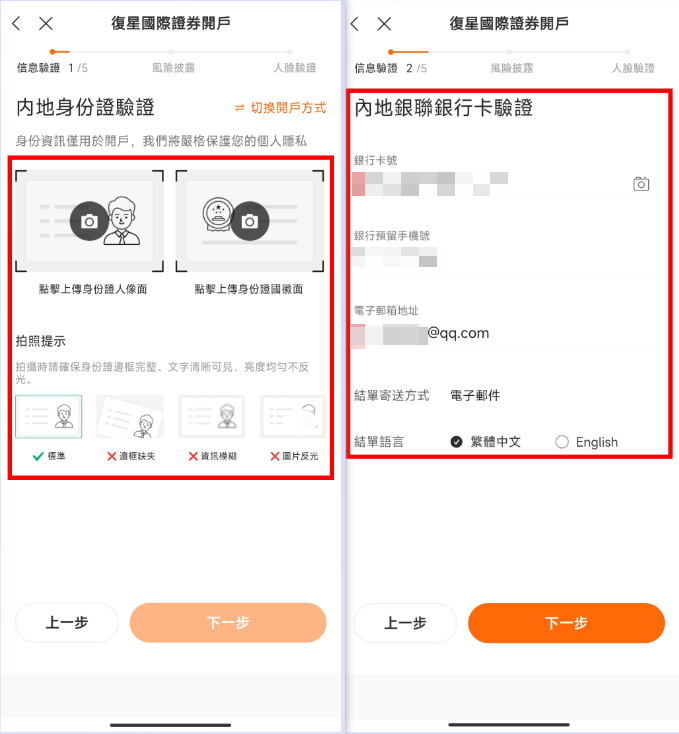

个人背景信息调查问卷

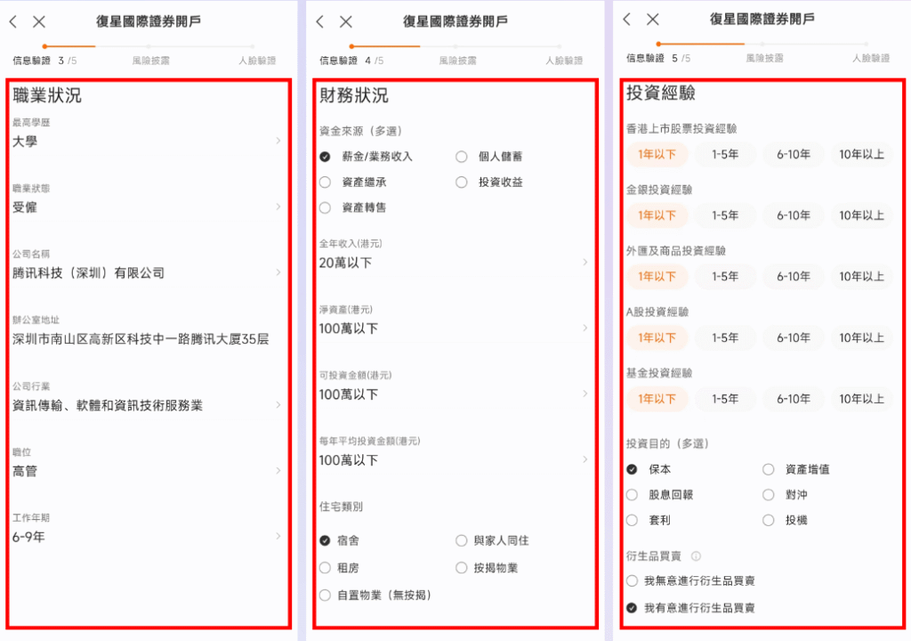

证券账户类型选择，建议直接开通保证金账户，可融资融券。如不需要，则选择现金账户。

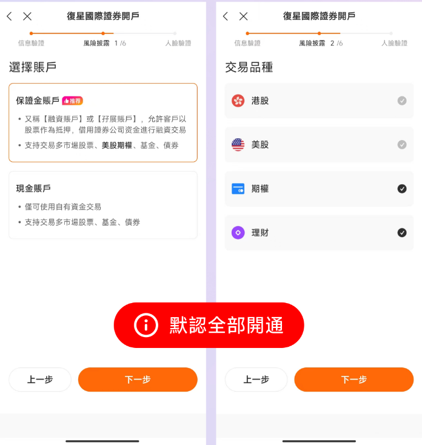

身份披露和税务信息，内地居民税务编号即身份证。

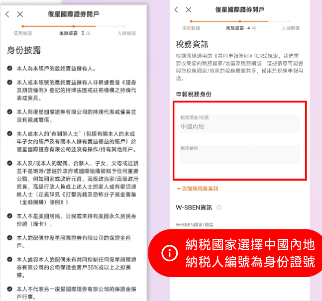

签署协议并签名

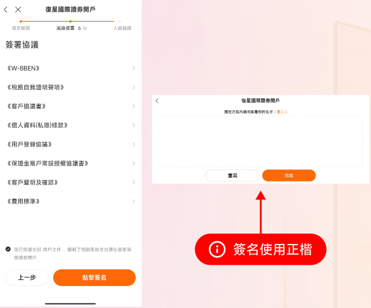

人脸识别并提交审核

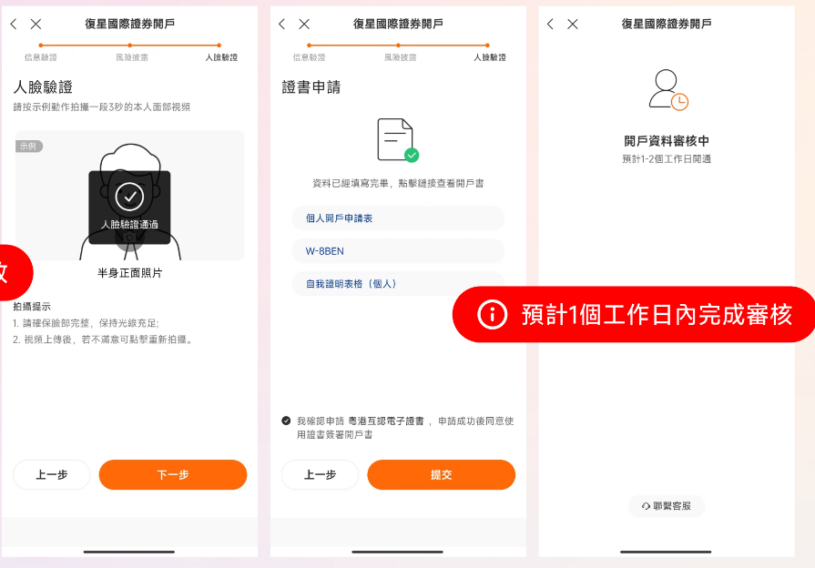

最后一步：完成 EDDA 授权，或者 1 万港币转账入金。

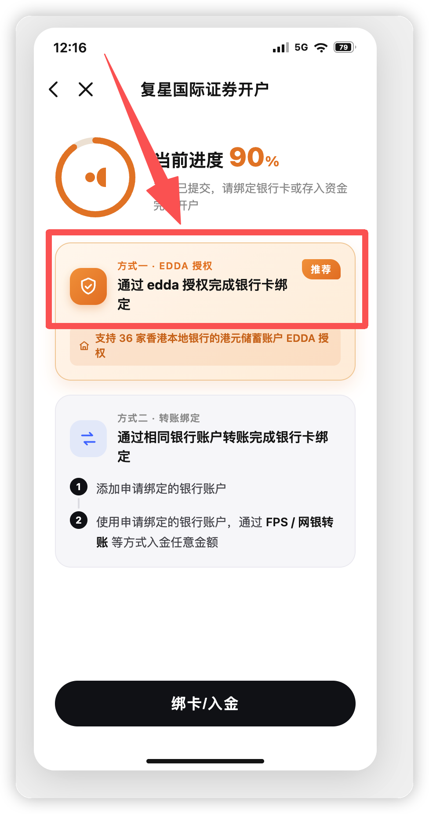

## **复星证券-星财富App下载**

复星证券的APP名字为【星财富】，具体安装方式如下：

- 安卓App下载：[https://www.fosunwealth.com/](https://apk.fosunhanig.com/download/fosunwealth-app.apk)
- 苹果手机：需要切换到美区或者港区的Appstore，然后在应用市场搜索 “星财富”

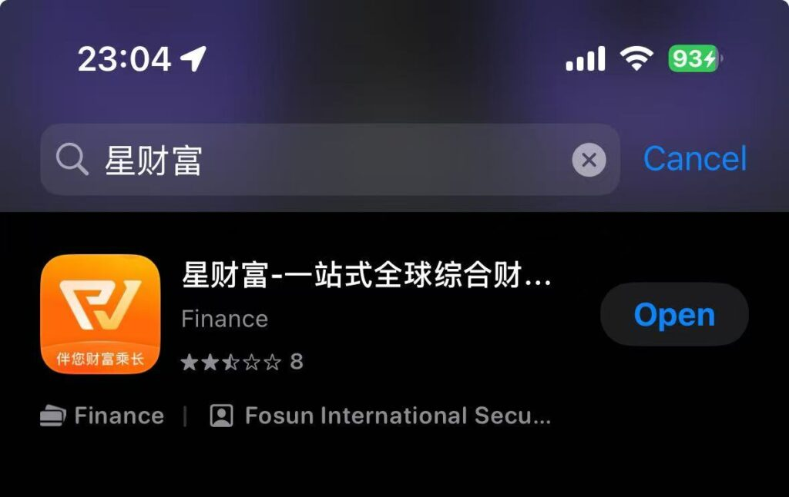

## 复星证券入金方式

### 港币入金

建议优先使用香港银行的eDDA通道，一次绑定，后续无需登录银行APP，可以直接在券商APP中划转资金到券商，5分钟到账。

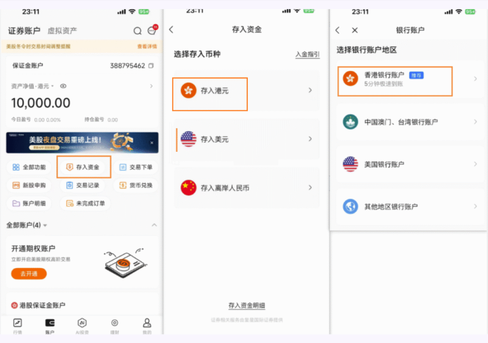
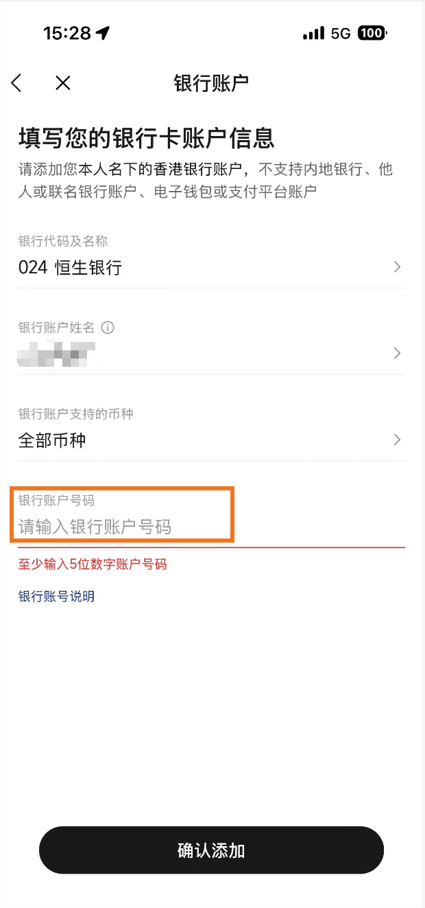

注意事项：

1. 银行账户登录银行 APP 查看，不是卡号。
2. 授权时需要填写银行对应的开户证件，汇丰渣打通常为港澳通行证号，中银、众安通常为身份证。

### 美元入金

美元入金只能在银行APP进行手动转账，需注意香港的美元转账不是实时的，通常要第二个工作日到账。

具体步骤如下：

1. 先在入金菜单中按照下面的方式，绑定自己的港卡或者其他境外银行卡

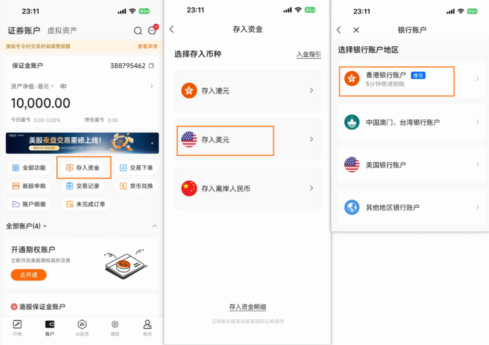

2. 获取到复星证券的对公收款账户。

星财富目前有三个对公账号，分别是渣打、汇丰和恒生，如果你正好从这几个银行转账美金，就选对应的对公账户，同行转账更快。

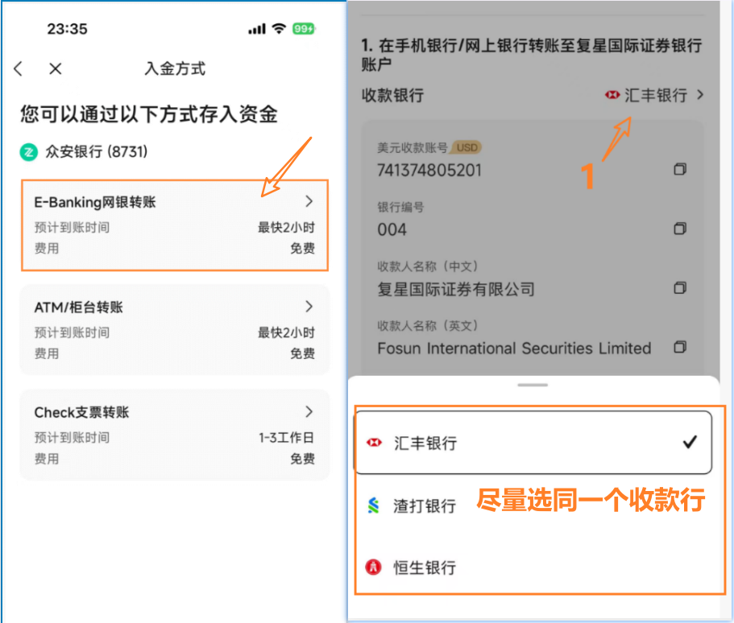

3. 然后在自己银行的APP中将美金汇入到该账户，汇款完成后，千万记得保存最后的汇款成功界面截图，并回到星财富APP上传截图。

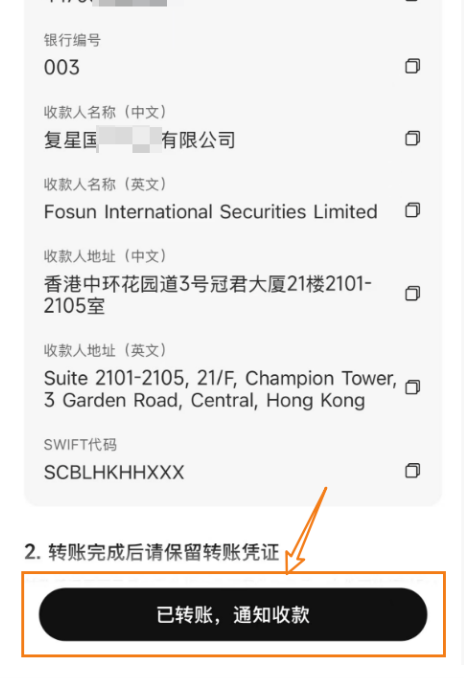

需要注意的是：香港所有银行美金转账只能在工作日处理，如果是当天下午三点前转账，通常当天可到，如果是三点后转，则需要到下一个工作日才能到账。
