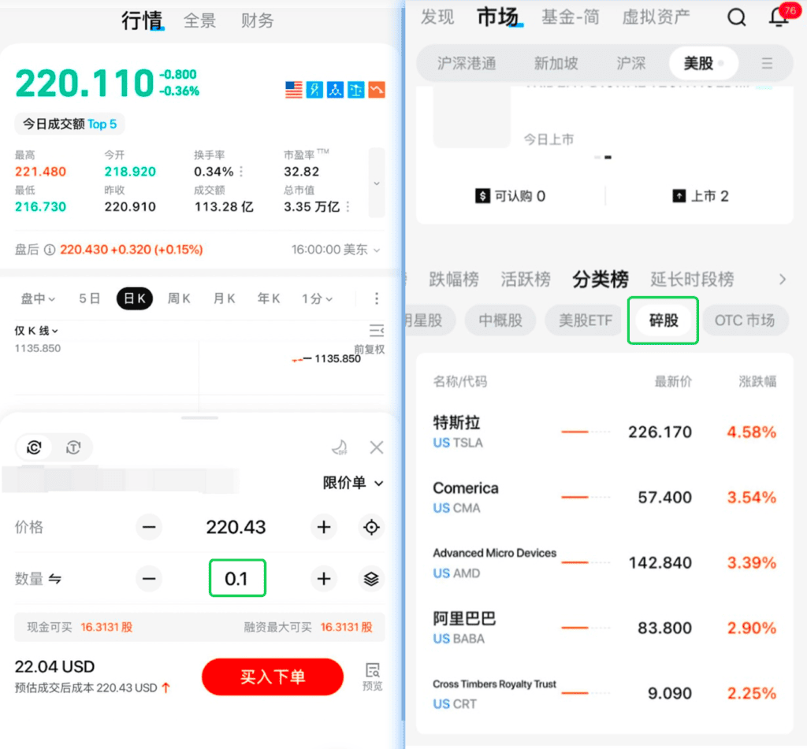
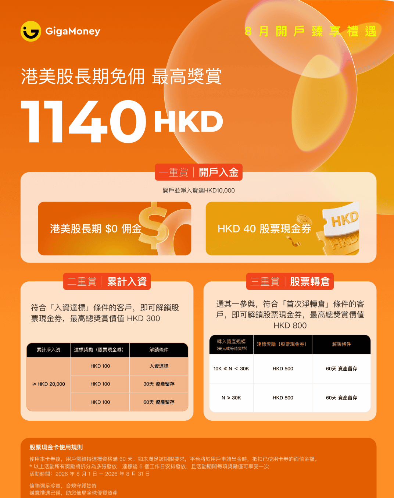
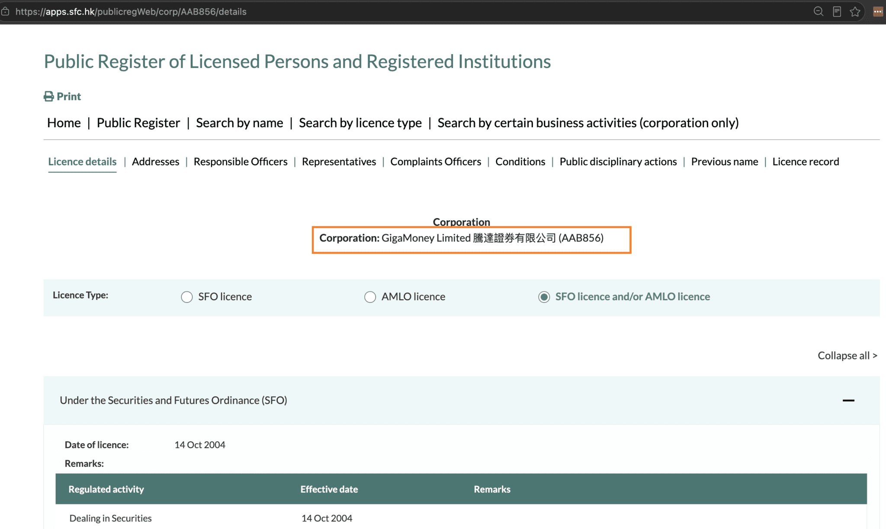
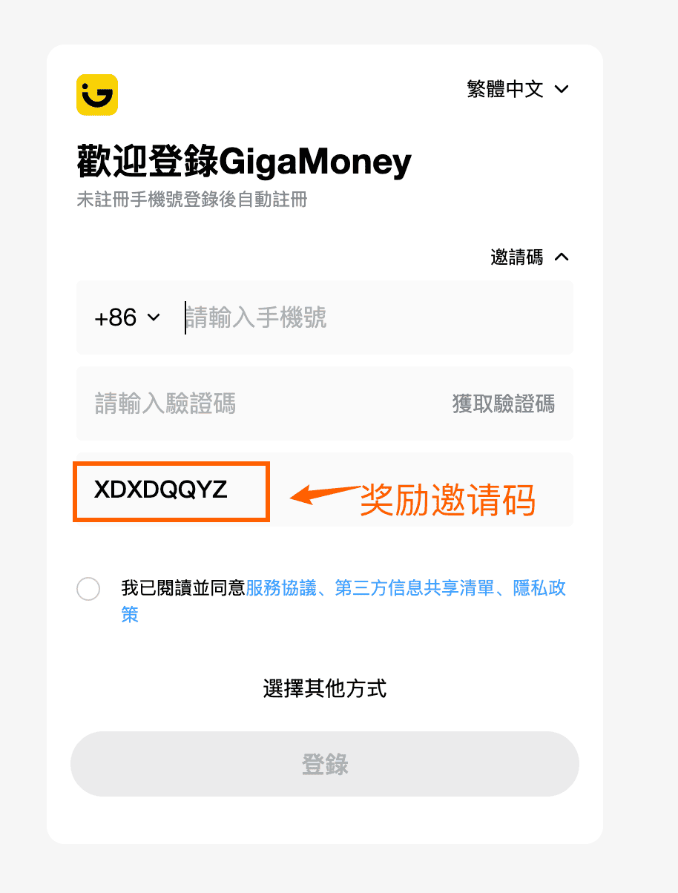
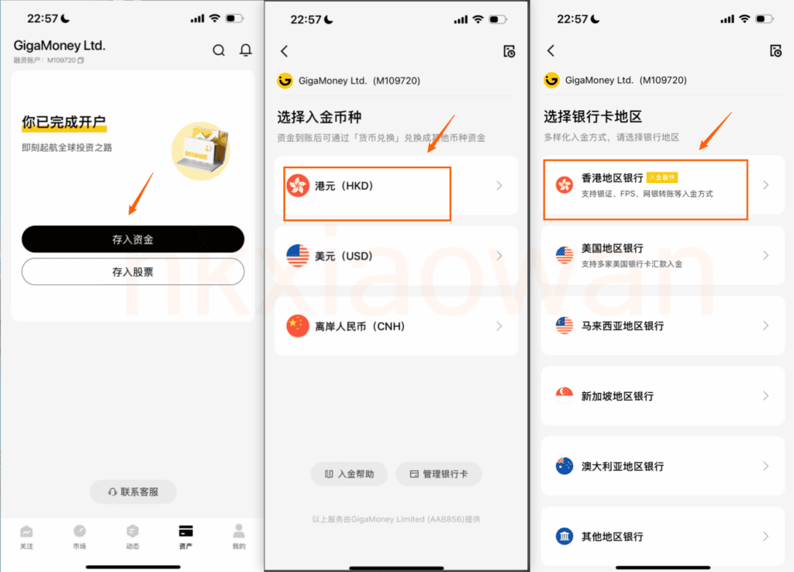
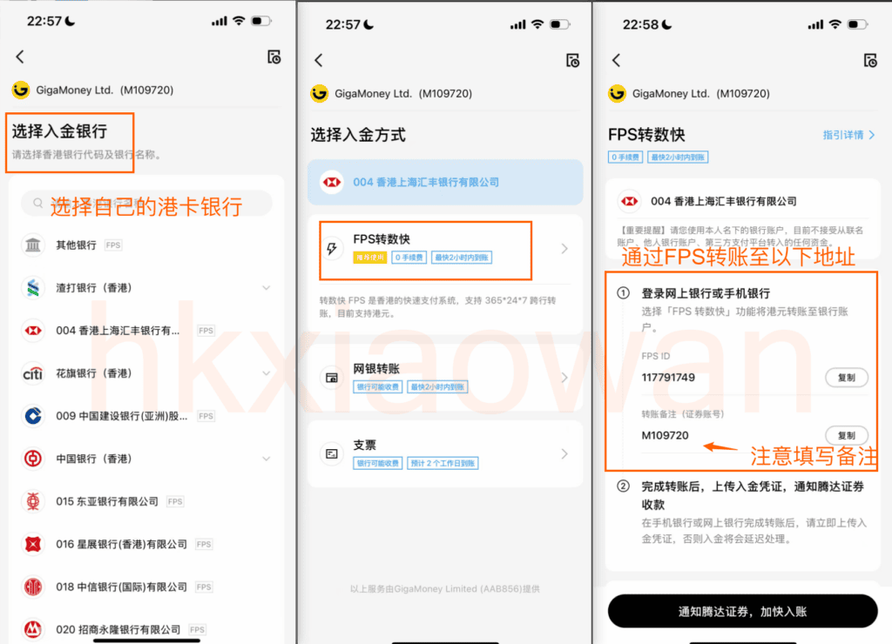
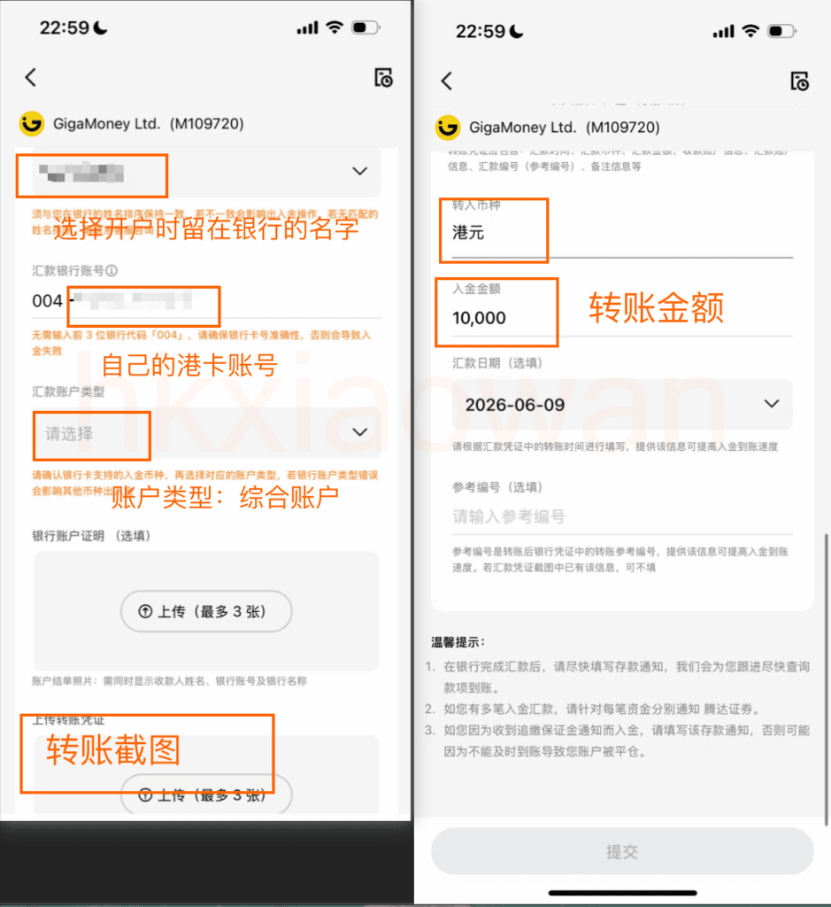

# GigaMoney 腾达证券开户指南 2026：开户条件、费用、奖励与入金教程

本文整理腾达证券（GigaMoney）的开户条件、开户奖励、交易费用、入金方式及完整开户流程。

### GigaMoney 腾达证券大陆居民可以开户吗？

截至 2026 年 8 月，腾达证券支持中国内地身份证用户在线开户，无需香港身份；但出入金需要一张本人名下的香港银行账户。

GigaMoney 是香港证监会认可的持牌法团，中央编号 **AAB856**，主要提供港股、美股、ETF、美股期权以及港股新股等交易服务。

小万实测：

2026 年 8 月 11 日，使用中国大陆居民身份证仍可提交开户申请。最终开户结果以 GigaMoney KYC 审核为准。

[查看腾达证券最新开户奖励](https://gigamoney.activity.wbrks.com/pages/winner/10849/index.html?app_id=winner&org_id=1&account_channel=hk_winner&lang=zh-HK&channel=kol&invite-code=XDXDQQYZ)

App 内开户邀请码：**XDXDQQYZ**

---

## 腾达证券（GigaMoney）基本信息

GigaMoney（腾达证券）是一家香港持牌券商，支持港股、美股交易。

|  |  |
| --- | --- |
| 品牌名称 | 腾达证券（GigaMoney） |
| 监管机构 | 香港证券及期货事务监察委员会（SFC） |
| 中央编号 | AAB856 |
| 开户方式 | App / 网页在线开户，无需临柜 |
| 开户身份 | 支持中国内地身份证，亦接受香港 / 海外身份 |
| 支持市场 | 港股、美股、ETF、美股期权 |
| 交易平台 | GigaMoney App（iOS / Android） |
| 主要特点 | 港美股免佣、碎股交易、盘前盘后、底层系统与长桥同源 |
| 出入金 | 需本人同名香港银行账户，港币支持 FPS 转数快 |

很多用户第一次使用时 Giga 腾达证券，会感觉界面风格和长桥证券很相似。没错，它的底层系统和长桥是完全一样的。

## 最新腾达证券开户奖励（有效期至 2026-08-31）

新用户通过以下任意一种方式开户，奖励相同：

1. 通过专属开户邀请链接注册：[Giga 腾达证券开户邀请链接](https://gigamoney.activity.wbrks.com/pages/winner/10849/index.html?app_id=winner&org_id=1&account_channel=hk_winner&lang=zh-HK&channel=kol&invite-code=XDXDQQYZ)
2. 下载 GigaMoney App，开户时手动输入邀请码：**XDXDQQYZ**

基础奖励

### 入金 HK$10,000

终生免佣 / HKD 40 现金券

通过邀请链接注册，完成开户流程并入金。

入金奖励

### 入金 HK$20,000

HKD 300 股票现金券

入金满 2万港币，并满足解锁条件可获得现金券。

转仓奖励

### 股票转仓

HKD 800 现金券

首次转仓达 1万港币可获 500 现金券，3w 可获 800 现金券。

[查看腾达证券最新开户奖励](https://gigamoney.activity.wbrks.com/pages/winner/10849/index.html?app_id=winner&org_id=1&account_channel=hk_winner&lang=zh-HK&channel=kol&invite-code=XDXDQQYZ)

### 领取奖励前务必确认

1. 必须通过指定邀请链接进入，或在 App 内填写邀请码 **XDXDQQYZ**；
2. 必须是首次注册的新用户；
3. 是否达到指定入金金额；
4. 是否满足资产留存时间；
5. 活动有效期；

## GigaMoney 腾达证券正规吗？安全吗？

腾达证券（GigaMoney）在香港持有证监会牌照开展业务，中央编号为 AAB856，用户可在香港证监会（SFC）持牌机构公众记录册中查询。

### 香港证监会持牌：中央编号 AAB856

**持有香港 SFC 牌照意味着什么？**

它至少证明这不是一个无牌 App，而是一家受香港证券监管体系监管的证券公司。

但「持牌」不等于投资没有风险，也不代表中国大陆监管部门批准其在境内主动开展证券业务。开户人仍需要自行评估跨境投资、政策变化及券商经营风险。

### ICF投资者赔偿基金：最高 HK$500,000

香港投资者赔偿基金在符合条件时可提供保障，但仅针对合资格中介机构违责的情形，不覆盖股价波动、市场风险或投资判断失误造成的亏损。

重要提示：

跨境互联网券商行业整体处于监管收紧阶段，富途、老虎、长桥等平台此前均曾受到监管关注或整改要求。行业普遍趋势是：限制内地新增用户，提高开户门槛。腾达证券目前对内地用户仍相对友好，但这属于阶段性政策，可能随时调整。

## GigaMoney 腾达证券手续费是多少？

GigaMoney 的收费模式并不是“完全零费用”。符合当前活动条件的用户可以获得港美股免佣权益，但交易时仍需支付平台费以及交易所、监管机构等收取的第三方费用。

| 交易产品 | 佣金 / 平台费（腾达证券收费） | 其他主要费用（外部费用） |
| --- | --- | --- |
| 港股 | **免佣**，平台费 HK$15 / 笔 | 印花税、交易征费、结算费等 |
| 美股 | **免佣**，US$0.005 / 股，200 股以内约 US$1 / 笔 | SEC 费、交收费等 |
| 美股期权 | 0.3 USD /张 （平台费） + 0.1 USD /张（佣金） | 交易所及监管费用 |
| 入金 / 出金 | 港币 FPS 转数快通常免费 | 银行电汇、跨境汇款可能产生银行费用 |

免佣资格与费率标准可能调整，实际收费以腾达证券官方费率页面为准（更新于 2026 年 8 月）。

## GigaMoney 开户需要什么资料？

腾达证券目前**支持中国内地身份证的用户在线开户**，同时也接受香港及海外身份用户申请；出入金环节需要本人名下的香港银行账户。

|  |  |
| --- | --- |
| 开户资格 | 支持中国内地身份证用户，亦接受香港 / 海外身份 |
| 年龄要求 | 年满 18 周岁 |
| 开户方式 | App / 网页在线开户 |
| 身份认证 | 身份证正反面 + 人脸识别 |
| 银行账户 | 本人同名香港银行账户 |
| 税务信息 | 税务居民身份及纳税人识别号 |

### 开户需要准备什么资料？

- **✓ 身份证明**：内地身份证正反面原件照片，四角完整、无反光、在有效期内。
- **✓ 手机号码**：可正常接收验证码，建议使用未注册过腾达证券的号码。
- **✓ 香港银行账户**：本人同名（汇丰、恒生、中银香港、众安、ZA、Mox 等）。
- **✓ 税务居民信息**：税务居民国家/地区与纳税人识别号（内地用户通常为身份证号）。

券商开户政策可能根据监管要求及内部审核标准调整，提交前以官方最新规则为准。

## 腾达证券开户流程（2026 最新）

### Step 1：通过邀请链接或邀请码进入注册

1. 点击[专属开户链接](https://gigamoney.activity.wbrks.com/pages/winner/10849/index.html?app_id=winner&org_id=1&account_channel=hk_winner&lang=zh-HK&channel=kol&invite-code=XDXDQQYZ)，或下载 GigaMoney App；
2. 输入手机号码，获取并填写验证码；
3. 如在 App 内开户，务必在「邀请码」栏输入：**XDXDQQYZ** 才能获取到新用户奖励。
4. 设置登录密码，完成基础注册。

重要提示

邀请关系在注册那一刻绑定。自行注册、之后再点邀请链接，通常无法补绑，也就拿不到新用户奖励。

### Step 2：提交身份认证

1. 上传身份证人像面与国徽面；
2. 核对自动识别出的姓名、身份证号、有效期；
3. 完成人脸识别（眨眼、转头等动作）。

> **重要提示：**避免反光与遮挡；身份证需在有效期内；识别信息有误必须手动修正后再提交。通常几分钟内完成。

### Step 3：填写个人与投资信息

1. 填写居住地址、职业、雇主信息；
2. 填写税务居民身份与纳税人识别号；
3. 完成投资经验、收入情况、风险偏好等 KYC 问卷。

> **重要提示：**请如实填写。不要为了通过审核而填写虚假国籍、地址或收入，资料不一致会直接影响审核与后续出入金。

### Step 4：提交申请并等待审核

1. 检查信息后提交开户申请；
2. 在 App 内查看审核状态。

> **重要提示：**资料完整时审核通常较快，多数当天通过。若被退回，按提示补充资料后重新提交。

### Step 5：完成入金

#### 港币入金：推荐 FPS 转数快（即时到账）

1. 在 App 内进入「入金」页面，选择港币；
2. 选择自己持有的港卡银行（港卡是汇丰就选汇丰）；
3. 获取腾达证券对应的收款 FPS ID；
4. 回到银行 App，使用 FPS 转数快完成转账（一定要注意备注信息）；
5. **转账完成后立即截图保存**；
6. 返回腾达证券 App，提交入金通知与转账凭证。

> **重要提示：**必须使用本人同名香港银行账户转出；不要复制网络文章里的历史收款账户，收款信息每次可能不同，以 App 内当次显示为准。

#### 美元入金：需网银电汇

美元入金只能通过银行手动转账 / 电汇，通常下一个工作日到账。

实用建议：主要投资美股可先入金港币，再在券商内换汇成美元，券商汇率通常优于银行。

### Step 6：开通交易权限

1. 港股：支持主板、ETF、部分打新；
2. 美股：支持纳斯达克、纽交所、ETF，支持盘前盘后与碎股；
3. 美股期权：需风险测评与投资经验审核后单独开通。

## 腾达证券开户容易出错的地方

- 先自行注册、后点邀请链接 → 邀请关系无法补绑，奖励失效；
- 入金银行账户与证券账户姓名不一致 → 入金被退回；
- 使用家人或朋友的港卡入金 → 无法通过合规审核；
- 复制旧文章里的收款账号 → 收款信息已变更，资金可能挂账；
- 身份证过期或照片反光 → 认证失败需重提；
- KYC 信息随意填写 → 审核被拒或后续出金受阻；
- 转账后未截图 → 无法提供凭证，入金确认变慢。

## 腾达证券 GigaMoney App 下载

为了确保资金安全，尽量通过官网渠道下载 最新版本APP。

- **苹果用户**：App Store 搜索 **GigaMoney** 下载；由于内地 Appstore 限制，苹果用户需切换到美区或者港区 Appstore 才能下载。具体参考：[苹果 Appstore 切换美区方法](01-项目库/06-%20go-global/repo/content/tools/appleid/index.md)
- **安卓用户**：通过官方渠道下载 APK 安装包，官网地址：<https://www.gigamoney.com/zh-HK/download> （由于内地限制，可能需要科学上网才能访问）。

## 腾达证券开户常见问题 FAQ

没有香港身份证可以开腾达证券吗？

可以。腾达证券目前支持使用中国内地身份证在线开户，这是它当前相对突出的一点。但开户政策可能随监管要求调整，申请前以官方页面为准。

没有香港银行卡可以开户吗？

注册和认证阶段通常可以完成，但出入金需要本人同名的香港银行账户。建议先办好港卡再开户，否则账户开通后无法入金交易。

可以用家人的香港银行账户入金吗？

不可以。券商要求入金账户与证券账户为同一人姓名，第三方入金会被退回，并可能触发合规审查。

已经注册腾达证券，再点邀请链接还能拿奖励吗？

通常不能。邀请关系在注册时绑定，事后点击链接一般无法重新绑定。参与新用户活动应先通过邀请链接进入，或注册时填写 XDXDQQYZ。

腾达证券和长桥证券是什么关系？

从用户体验看，GigaMoney 的 App 界面与交互风格与长桥证券高度接近，底层系统同源。但两者是不同持牌主体，账户、活动与费率各自独立。

腾达证券真的免佣吗？

港股、美股佣金为 0，入金满 1 万港币可获得终生免佣资格。但港股仍有 HK$15/笔平台费，美股按 US$0.005/股收取（200 股以内约 US$1），另有交易所、监管、印花税等第三方费用。

入金多久到账？

港币通过 FPS 转数快通常即时到账；美元电汇通常需要一个工作日，具体受银行处理时间影响。

审核一般需要多久？

资料完整的情况下多数当天通过。审核时间取决于资料完整度、身份类型与平台审核队列。

可以交易美股期权吗？

部分用户可开通。需通过风险测评并具备相应投资经验，由券商审核后开通权限。

开户前最需要确认什么？

确认四件事：是否已有本人同名港卡、是否通过邀请链接或邀请码注册、当前活动的入金与留存要求、以及自己能承受的投资风险。

### 查看腾达证券当前开户优惠

如果你已经确认符合腾达证券当前开户条件，可以通过指定邀请链接进入官方页面，查看最新开户奖励、入金要求及活动规则。

[立即查看腾达证券开户奖励](https://gigamoney.app.wbrks.com/session/login?app_id=winner&org_id=1&account_channel=hk_winner&lang=zh-HK&channel=kol&invite-code=XDXDQQYZ&oa_redirect_url=https%3A%2F%2Fgigamoney.activity.wbrks.com%2Fpages%2Fwinner%2F10849%2Findex.html%3Fapp_id%3Dwinner%26org_id%3D1%26account_channel%3Dhk_winner%26lang%3Dzh-HK%26channel%3Dkol%26invite-code%3DXDXDQQYZ&redirect_url=https%3A%2F%2Fgigamoney.app.wbrks.com%2Fac%2Foa%3Fapp_id%3Dwinner%26org_id%3D1%26account_channel%3Dhk_winner%26lang%3Dzh-HK%26channel%3Dkol%26invite-code%3DXDXDQQYZ%26oa_redirect_url%3Dhttps%3A%2F%2Fgigamoney.activity.wbrks.com%2Fpages%2Fwinner%2F10849%2Findex.html%3Fapp_id%3Dwinner%2526org_id%3D1%2526account_channel%3Dhk_winner%2526lang%3Dzh-HK%2526channel%3Dkol%2526invite-code%3DXDXDQQYZ)

邀请码：**XDXDQQYZ**｜开户链接、奖励金额、活动期限及参与条件可能调整，请以官方活动页面显示为准。

---

推广说明

本文包含银行或证券开户邀请链接。如果用户通过本文邀请链接注册，并满足相关活动条件，用户可以获得邀请奖励，本站也可能获得推广佣金，推广佣金不会增加用户开户成本。

风险提示

本文不构成投资建议、收益承诺或购买建议。证券投资存在风险，投资者可能损失部分甚至全部本金。投资前请充分了解相关产品特点，并根据自身风险承受能力谨慎判断。
