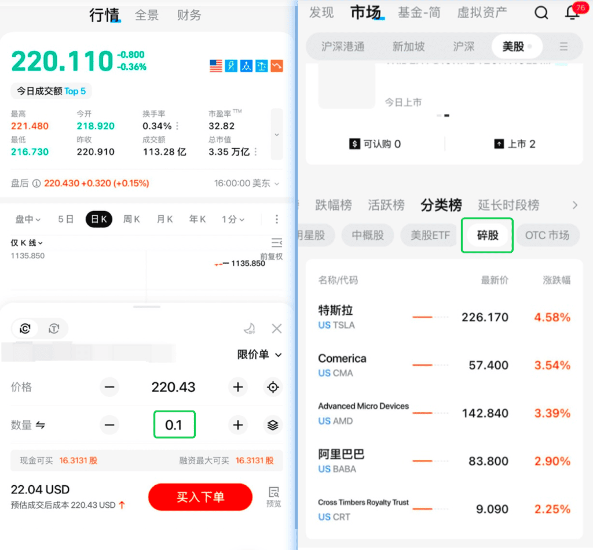
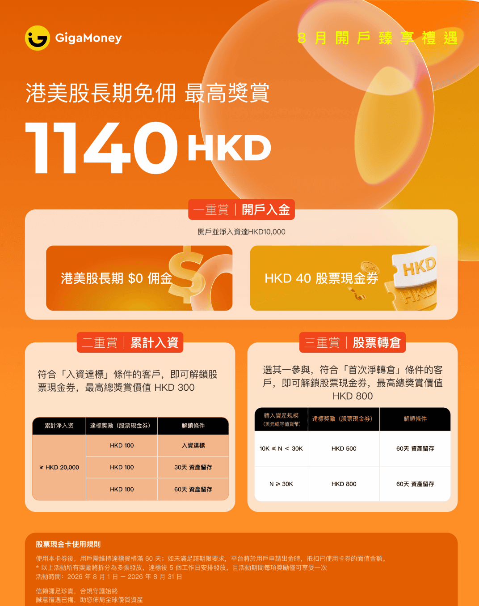
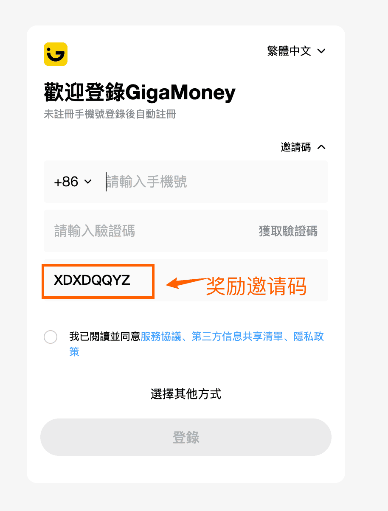
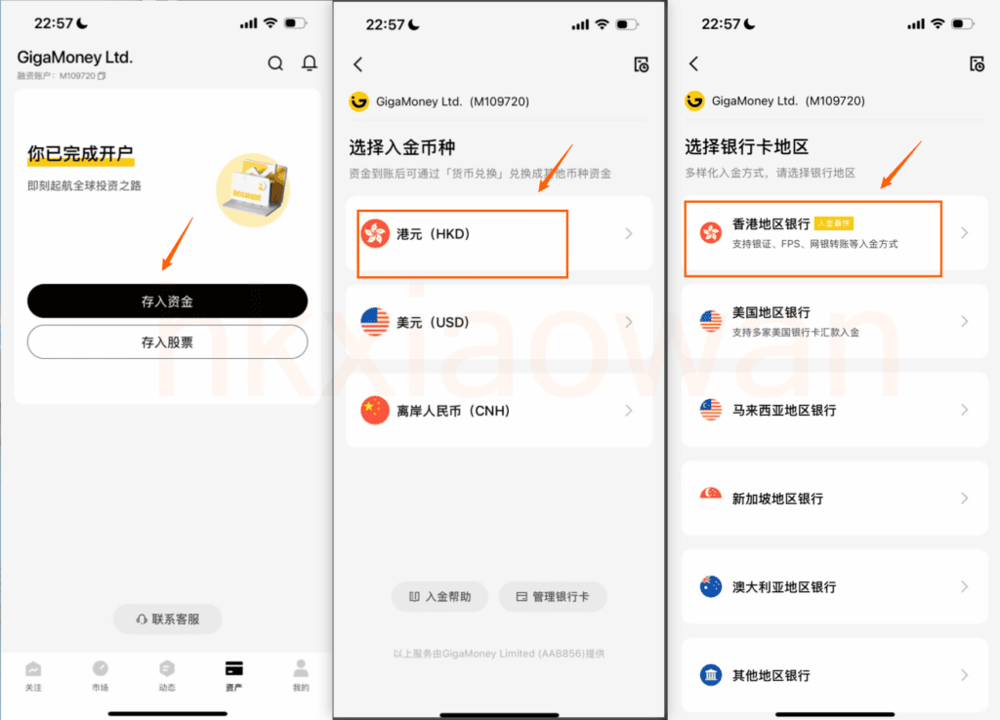
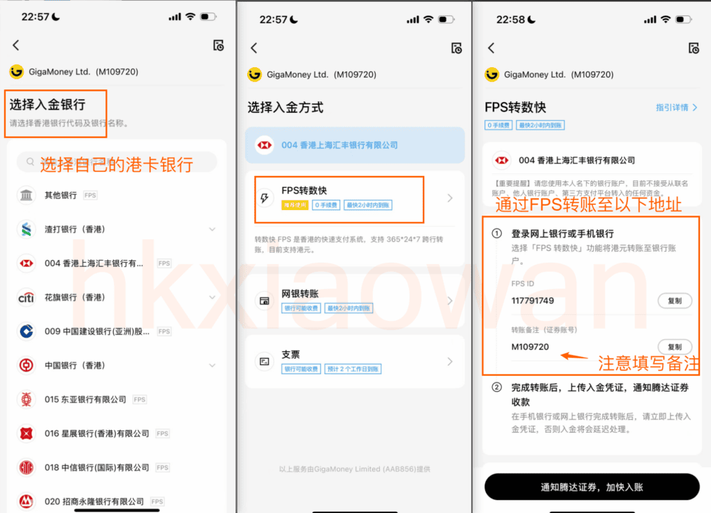
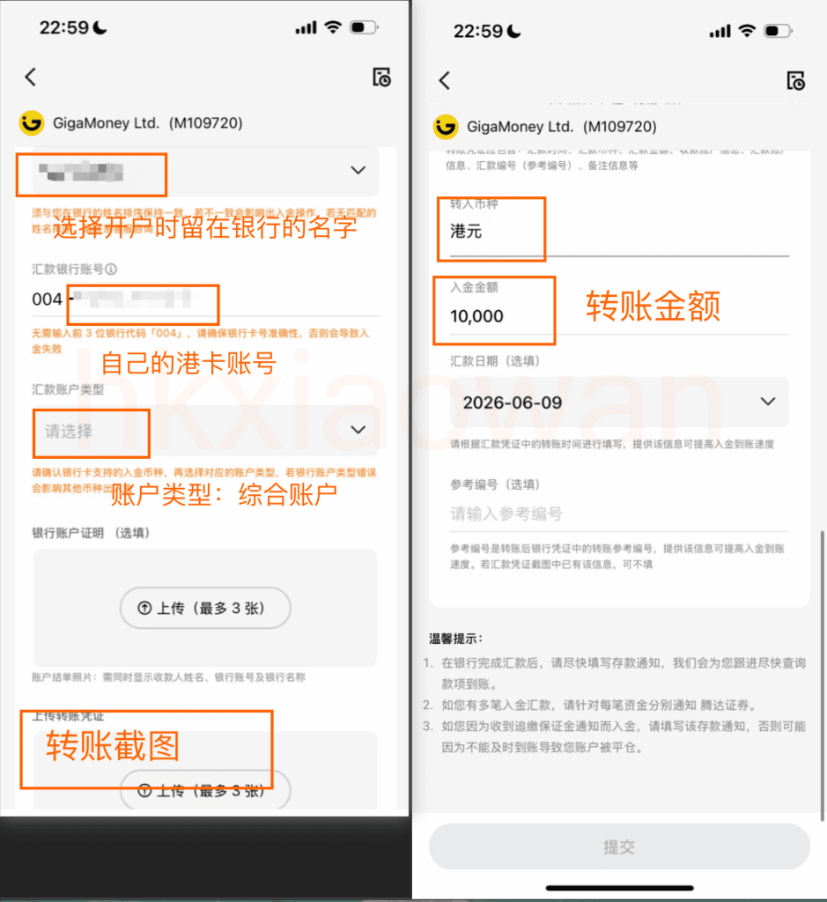

# GigaMoney 腾达证券开户指南 2026：开户条件、费用、奖励与入金教程

### GigaMoney 腾达证券

GigaMoney 是香港证监会认可的持牌法团，中央编号 **AAB856**，主要提供港股、美股、ETF、美股期权以及港股新股等交易服务。

腾达证券支持中国内地身份证用户在线开户，但出入金需要一张本人名下的香港银行账户。

---

## 腾达证券（GigaMoney）基本信息

GigaMoney（腾达证券）是一家香港持牌券商，支持港股、美股交易。

| 品牌名称 | 腾达证券（GigaMoney）              |
| ---- | ---------------------------- |
| 监管机构 | 香港证券及期货事务监察委员会（SFC）          |
| 中央编号 | AAB856                       |
| 开户方式 | App / 网页在线开户，无需临柜            |
| 开户身份 | 支持中国内地身份证，亦接受香港 / 海外身份       |
| 支持市场 | 港股、美股、ETF、美股期权               |
| 交易平台 | GigaMoney App（iOS / Android） |
| 主要特点 | 港美股免佣、碎股交易、盘前盘后、底层系统与长桥同源    |
| 出入金  | 需本人同名香港银行账户，港币支持 FPS 转数快     |

很多用户第一次使用时 Giga 腾达证券，会感觉界面风格和长桥证券很相似。没错，它的底层系统和长桥是完全一样的。

## 最新腾达证券开户奖励

新用户通过以下任意一种方式开户，奖励相同：

1. 通过专属开户邀请链接注册：[Giga 腾达证券开户邀请链接](https://gigamoney.activity.wbrks.com/pages/winner/10849/index.html?app_id=winner&org_id=1&account_channel=hk_winner&lang=zh-HK&channel=kol&invite-code=XDXDQQYZ)
2. 下载 GigaMoney App，开户时手动输入邀请码：**XDXDQQYZ**

[查看腾达证券最新开户奖励](https://gigamoney.activity.wbrks.com/pages/winner/10849/index.html?app_id=winner&org_id=1&account_channel=hk_winner&lang=zh-HK&channel=kol&invite-code=XDXDQQYZ)

## GigaMoney 腾达证券交易手续费？

GigaMoney 的收费模式并不是“完全零费用”。符合当前活动条件的用户可以获得港美股免佣权益，但交易时仍需支付平台费以及交易所、监管机构等收取的第三方费用。

| 交易产品    | 佣金 / 平台费（腾达证券收费）                      |
| ------- | ------------------------------------- |
| 港股      | **免佣**，平台费 HK$15 / 笔                  |
| 美股      | **免佣**，US$0.005 / 股，200 股以内约 US$1 / 笔 |
| 美股期权    | 0.3 USD /张 （平台费） + 0.1 USD /张（佣金）     |
| 入金 / 出金 | 港币 FPS 转数快通常免费                        |

## 腾达证券开户流程（2026 最新）

### Step 1：通过邀请链接或邀请码注册

1. 点击[专属开户链接](https://gigamoney.activity.wbrks.com/pages/winner/10849/index.html?app_id=winner&org_id=1&account_channel=hk_winner&lang=zh-HK&channel=kol&invite-code=XDXDQQYZ)，或下载 GigaMoney App；
2. 输入手机号码，获取并填写验证码；
3. 如在 App 内开户，务必在「邀请码」栏输入：**XDXDQQYZ** 才能获取到新用户奖励。
4. 设置登录密码，完成基础注册。

重要提示

邀请关系在注册那一刻绑定。自行注册、之后再点邀请链接，通常无法补绑，也就拿不到新用户奖励。

### Step 2：提交身份认证

1. 上传身份证人像面与国徽面；
2. 核对自动识别出的姓名、身份证号、有效期；
3. 完成人脸识别（眨眼、转头等动作）。

> **重要提示：**避免反光与遮挡；身份证需在有效期内；识别信息有误必须手动修正后再提交。通常几分钟内完成。

### Step 3：填写个人与投资信息

1. 填写居住地址、职业、雇主信息；
2. 填写税务居民身份与纳税人识别号；
3. 完成投资经验、收入情况、风险偏好等 KYC 问卷。

> **重要提示：**请如实填写。不要为了通过审核而填写虚假国籍、地址或收入，资料不一致会直接影响审核与后续出入金。

### Step 4：提交申请并等待审核

1. 检查信息后提交开户申请；
2. 在 App 内查看审核状态。

> **重要提示：**资料完整时审核通常较快，多数当天通过。若被退回，按提示补充资料后重新提交。

### Step 5：完成入金

#### 港币入金：推荐 FPS 转数快（即时到账）

1. 在 App 内进入「入金」页面，选择港币；
2. 选择自己持有的港卡银行（港卡是汇丰就选汇丰）；
3. 获取腾达证券对应的收款 FPS ID；
4. 回到银行 App，使用 FPS 转数快完成转账（一定要注意备注信息）；
5. **转账完成后立即截图保存**；
6. 返回腾达证券 App，提交入金通知与转账凭证。

> **重要提示：**必须使用本人同名香港银行账户转出；不要复制网络文章里的历史收款账户，收款信息每次可能不同，以 App 内当次显示为准。

#### 美元入金：需网银电汇

美元入金只能通过银行手动转账 / 电汇，通常下一个工作日到账。

实用建议：主要投资美股可先入金港币，再在券商内换汇成美元，券商汇率通常优于银行。

### Step 6：开通交易权限

1. 港股：支持主板、ETF、部分打新；
2. 美股：支持纳斯达克、纽交所、ETF，支持盘前盘后与碎股；
3. 美股期权：需风险测评与投资经验审核后单独开通。

## 腾达证券 GigaMoney App 下载

为了确保资金安全，尽量通过官网渠道下载 最新版本APP。

- **苹果用户**：App Store 搜索 **GigaMoney** 下载；由于内地 Appstore 限制，苹果用户需切换到美区或者港区 Appstore 才能下载。具体参考：苹果 Appstore 切换美区方法
- **安卓用户**：通过官方渠道下载 APK 安装包，官网地址：<https://www.gigamoney.com/zh-HK/download> （由于内地限制，可能需要科学上网才能访问）。

### 查看腾达证券当前开户优惠

如果你已经确认符合腾达证券当前开户条件，可以通过指定邀请链接进入官方页面，查看最新开户奖励、入金要求及活动规则。

[查看腾达证券最新开户奖励](https://gigamoney.app.wbrks.com/session/login?app_id=winner&org_id=1&account_channel=hk_winner&lang=zh-HK&channel=kol&invite-code=XDXDQQYZ&oa_redirect_url=https%3A%2F%2Fgigamoney.activity.wbrks.com%2Fpages%2Fwinner%2F10849%2Findex.html%3Fapp_id%3Dwinner%26org_id%3D1%26account_channel%3Dhk_winner%26lang%3Dzh-HK%26channel%3Dkol%26invite-code%3DXDXDQQYZ&redirect_url=https%3A%2F%2Fgigamoney.app.wbrks.com%2Fac%2Foa%3Fapp_id%3Dwinner%26org_id%3D1%26account_channel%3Dhk_winner%26lang%3Dzh-HK%26channel%3Dkol%26invite-code%3DXDXDQQYZ%26oa_redirect_url%3Dhttps%3A%2F%2Fgigamoney.activity.wbrks.com%2Fpages%2Fwinner%2F10849%2Findex.html%3Fapp_id%3Dwinner%2526org_id%3D1%2526account_channel%3Dhk_winner%2526lang%3Dzh-HK%2526channel%3Dkol%2526invite-code%3DXDXDQQYZ)

邀请码：**XDXDQQYZ**｜开户链接、奖励金额、活动期限及参与条件可能调整，请以官方活动页面显示为准。

---

风险提示

本文不构成投资建议、收益承诺或购买建议。证券投资存在风险，投资者可能损失部分甚至全部本金。投资前请充分了解相关产品特点，并根据自身风险承受能力谨慎判断。
