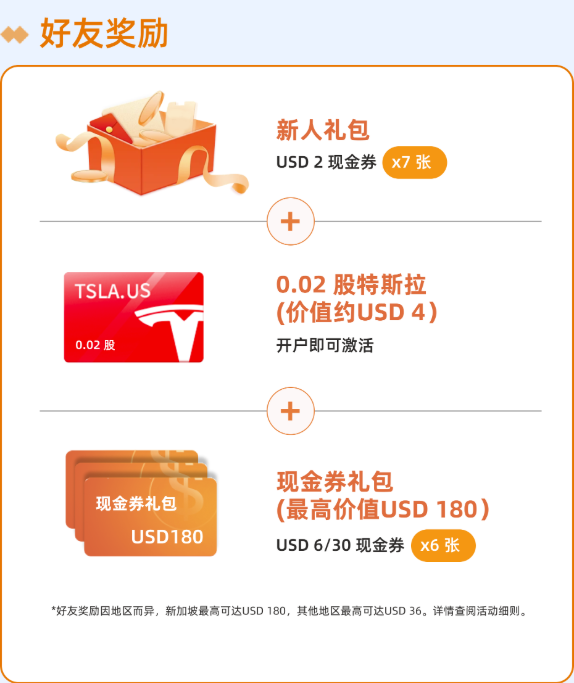
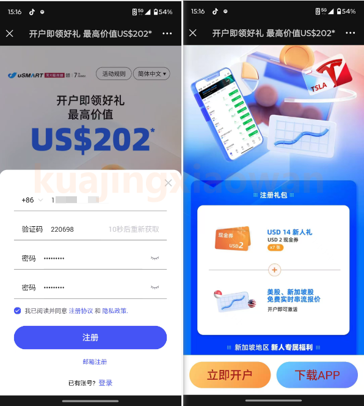
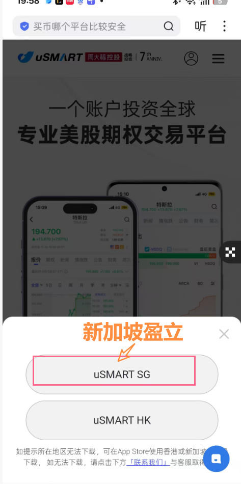
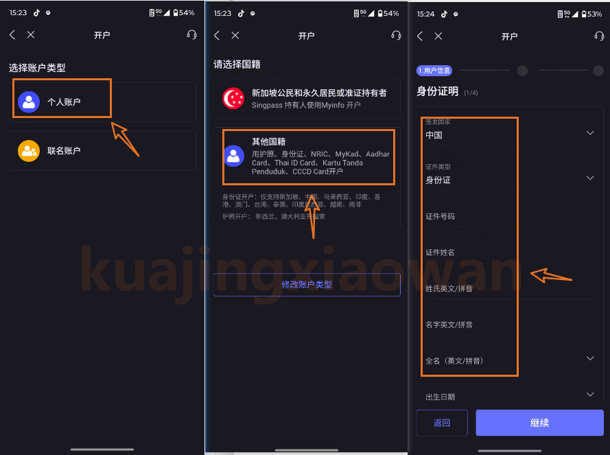
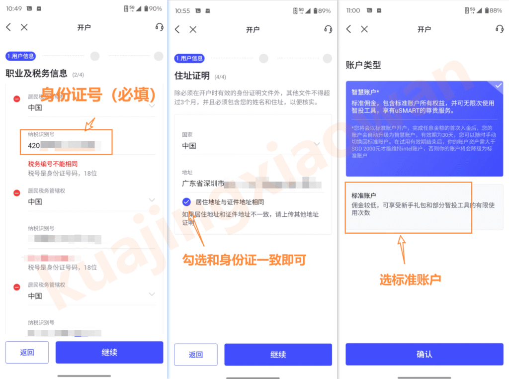
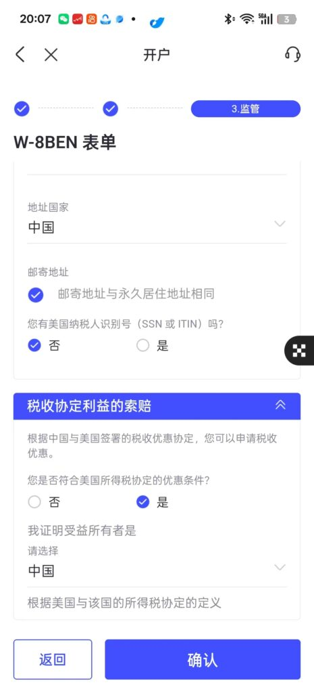
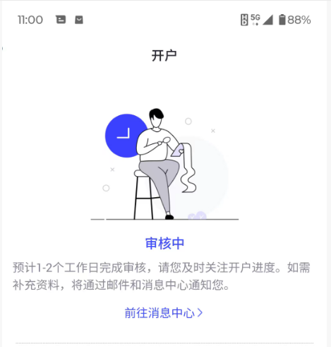
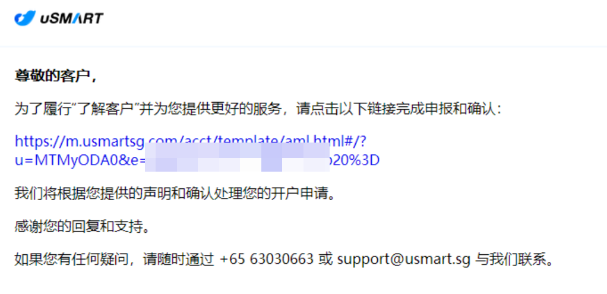
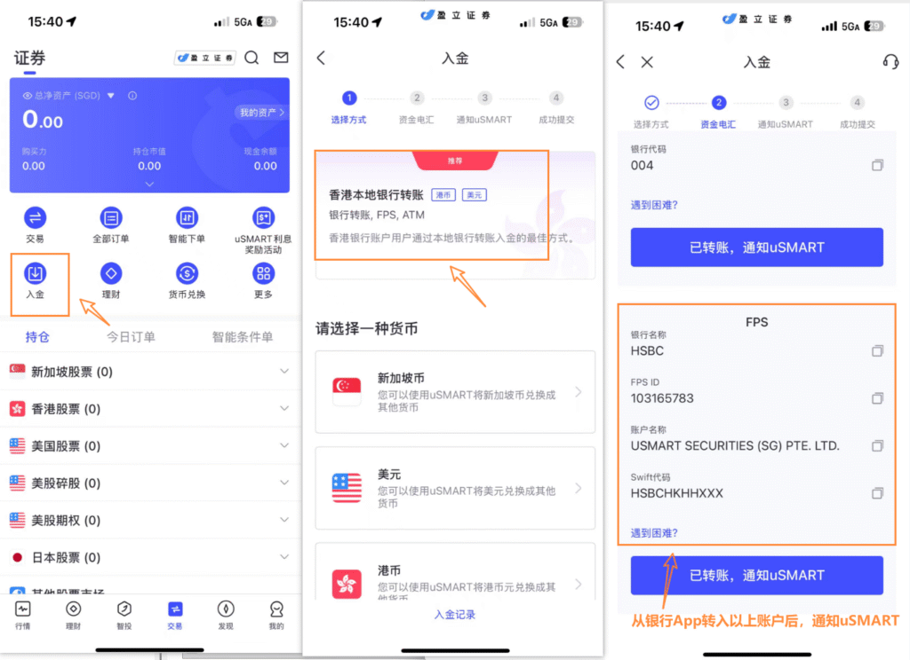

# uSMART 盈立新加坡开户指南 2026｜内地身份证可开｜新用户最高领约 54 新币奖励

本文整理 uSMART 盈立证券（新加坡）开户条件、开户奖励、入金要求、交易费用及完整开户流程，并说明盈立香港与盈立新加坡的区别。

**uSMART 盈立新加坡是目前仍可用内地身份证直接开户的知名港资背景券商之一；**

**522 新政后注册环节会校验网络出口 IP，必须使用香港或海外网络，无法在内地网络下直接注册。**具体政策以盈立官方最新要求为准。

[查看 uSMART 盈立（新加坡）最新开户奖励](https://m.usmartsg66.com/promo/overseas/bonus-dec.html?ICode=73qr&langType=1&Id=)

App 开户邀请码：**73qr**（注册全程需保持境外网络）

## 快速了解 uSMART 盈立新加坡

|  |  |
| --- | --- |
| 品牌名称 | uSMART 盈立证券（新加坡） |
| 集团背景 | uSMART 盈立集团总部位于香港，为周大福旗下券商品牌 |
| 监管机构 | [新加坡金融管理局（MAS）](https://eservices.mas.gov.sg/fid/institution/detail/246811-USMART-SECURITIES-SINGAPORE-PTE-LTD) 编号：CMS101161 |
| 开户资格 | 内地身份证可开；注册需香港或海外 IP |
| 开户方式 | 邀请链接注册 + 官方 App 内提交资料 |
| 支持市场 | 美股、港股 、日股、新加坡股票 / ETF / 期权等 |
| 账户类型 | 标准账户、智慧账户（收费模式不同） |
| 交易平台 | uSMART SG App（iOS / Android）、网页端 |
| 入金方式 | 支持香港银行卡无损入金港币 |
| 主要特点 | 身份证可开、可交易资产类型多、新用户现金券 + 碎股奖励 |

## uSMART 盈立新加坡开户奖励（有效期至 2026 年 12 月 31 日）

以下奖励需通过指定邀请链接或邀请码 **73qr** 注册，并在**开户后 30 天内入金满 2,000 美元或等值货币**，且**30 天内完成至少一笔股票买入交易**。

基础奖励

美股交易现金券

7 张 US$2 现金券

交易美股时可直接冲抵费用，合计约 US$14。使用条件与有效期以 App 卡券中心显示为准。

股票奖励

特斯拉碎股

0.02 股 TSLA（价值约 US$4）

碎股价值随股价波动，发放后可自行持有或卖出。以领取时市价计算。

最高奖励

额外现金券（按身份区分）

内地居民 6 × US$6｜

该档位按开户身份区分：内地居民合计约 US$36。以活动规则为准。

### 两种开户入口

- **邀请链接开户**：[点击进入盈立新加坡开户页](https://m.usmartsg66.com/promo/overseas/bonus-dec.html?ICode=73qr&langType=1&Id=)
- **App 开户**：下载 uSMART SG 后，在注册页填写邀请码 **73qr**

### 领取奖励前必须确认什么？

1. 是否通过指定邀请链接进入，或在注册时填写邀请码 **73qr**；
2. 是否属于活动定义的新用户（已注册用户通常需注销后重新开户）；
3. 入金金额是否达到 2,000 美元或等值货币；
4. 是否在 30 天内完成一笔股票买入交易；
5. 资产是否需要留存指定天数 [待核实]；
6. 活动有效期与奖励发放时间，以及最终官方活动规则。

[查看 uSMART 盈立新加坡最新开户奖励](https://m.usmartsg66.com/promo/overseas/bonus-dec.html?ICode=73qr&langType=1&Id=)

## uSMART 盈立新加坡安全吗？

uSMART 盈立新加坡通过其新加坡持牌主体开展业务，并受新加坡金融管理局（MAS）监管；集团总部位于香港，为周大福旗下券商品牌。

### 新加坡 MAS 持牌

持牌意味着其证券业务须遵守新加坡相关法规，编号：CMS101161，可在 MAS 金融机构名录中核实。

### 周大福集团背景

uSMART 盈立证券为香港知名品牌周大福旗下的券商公司，相比缺乏可核实股东背景的平台，集团背景与长期经营记录更容易验证。

### 防诈骗提醒

- 开户仅通过官方注册页与官方 App 进行，不要将资料交给第三方代办；
- App 下载优先使用官网下载页：[usmart.sg/cn/download](https://www.usmart.sg/cn/download)；
- 入金收款账户信息务必每次从官方 App 内重新获取。

## uSMART 盈立新加坡交易费用

盈立新加坡提供**标准账户**与**智慧账户**两种收费模式：

- 标准账户美股 0 佣金、只收平台费；
- PRO智慧账户在平台费之外另收佣金，但提供更多功能权益。
- 不同产品仍可能涉及交易所、监管、结算等第三方费用。

| 交易产品 | 标准账户 | 智慧账户 |
| --- | --- | --- |
| 美股 | **0 佣金**；平台费每股 US$0.009，每笔最低 US$1.88，上限为成交额 1% | 平台费同标准账户；另收佣金，每笔最低 US$1，上限为成交额 0.5% |
| 港股 | 佣金 **0.03%** + 每笔 HK$12 | 佣金 0.06% + 每笔 HK$15 |
| 港股第三方费用 | 印花税、证监会交易征费、交易所征费、结算费等 | 同左 |
| 美股第三方费用 | SEC 费、FINRA 费、清算费、ADR 费等 | 同左 |
| 换汇 | App 内换汇，汇率通常优于银行柜台 | 同左 |

上表为开户时系统展示的账户类型收费口径整理，截至 2026 年 8 月。收费方案可能调整，实际适用以官方收费页及开户时系统显示为准。

**怎么选账户类型？**如果你主要做美股买卖、看重单笔成本，标准账户的 0 佣金结构通常更直接；如果你需要智慧账户附带的功能权益，再评估佣金成本是否值得。账户类型的具体权益差异请在开户页面逐项确认。

## uSMART 盈立新加坡开户条件,需要准备什么资料?

- ✓ **身份证明**：本人二代身份证正反面清晰照片，证件未过期。
- ✓ **境外网络**：香港或海外节点，注册到提交全程保持一致。
- ✓ **手机号 / 邮箱**：可正常接收验证码与审核补件通知。
- ✓ **税务居民信息**：税务居住地 + 税务编号（内地居民为身份证号）。
- ✓ **银行账户**：本人同名香港银行账户，用于入金与出金。
- ✓ **职业与收入信息**：职业、雇主、资金来源，按真实情况填写。

券商开户政策可能根据监管要求及内部审核标准调整，提交申请前请以官方最新规则及 App 内实际显示为准。

## 盈立新加坡开户流程

### 1. 通过邀请链接注册

务必通过[本文邀请链接](https://m.usmartsg66.com/promo/overseas/bonus-dec.html?ICode=73qr&langType=1&Id=)注册才能获取全部优惠奖励，如之前已注册，需要先注销账户再重新点击链接开户。

### 2. App下载

通过邀请链接注册后，就可以下载APP，然后在app里面完成开户流程。

- 安卓用户下载链接：[安卓APK包](https://jy-common-sg-prd-singapore-1257884527.cos.ap-singapore.myqcloud.com/admin/app-version-file/2025-08-12/4c01dc45-c71d-4a2f-ba95-73cd401e0f59/sg-client-6.0.0-202508111811-release.apk), 其他版本参考官网下载链接：<https://www.usmart.sg/cn/download>
- 苹果用户需将Appstore切换到美区或者港区才能下载 usmart sg，具体参考：https://xiaowan.hk/appleid

### 3. APP内提交开户资料

然后在App里面的开户菜单提交开户流程。

其他资料照提示填写即可。

**美股交易：**

- 标准账户：只有平台费，没有佣金，平台费每股0.009美金，每笔订单最低1.88美金，最高1%。
- 智慧账户：美股交易平台费+佣金，平台费和标准账户一样，佣金每笔最低1美金，最高0.5%。

**港股交易：**

- 标准账户：佣金0.03% + 12港币每笔 + 印花税等杂费
- 智慧账户：佣金0.06% + 15港币每笔 + 印花税等杂费

**W-8BEN表单填写：**

全部流程走完后，即提交后台审批。

提交完成后，注意查收邮箱，有可能会需要补充额外信息，根据实际情况回复即可。

最快当天就可以收到开通通知。

### 入金

盈立新加坡支持香港银行卡无损入金港币。**第一次入金建议大于1.5w港币**（需超过2000美金），才能获取全部新用户奖励。

## uSMART 盈立新加坡开户常见 FAQ

内地居民可以开 uSMART 盈立新加坡账户吗？

可以。盈立新加坡目前仍接受内地居民凭身份证申请，是 522 新政后少数保留该路径的知名券商之一。但注册环节会校验网络出口 IP，必须使用香港或海外网络。

在国内网络下能注册盈立新加坡吗？

不能。522 新政后盈立开户会检查 IP 地址是否为香港或境外，内地网络无法直接完成注册。注册前请先切换到香港或海外节点，并在整个流程中保持一致。

应该开盈立香港还是盈立新加坡？

建议优先注册盈立新加坡。受内地监管要求影响，盈立香港账户的功能与市场开放范围更受限；盈立新加坡功能更齐全、限制更少。如果你持有香港身份并更看重香港本地监管与投资者赔偿基金保障，可再评估盈立香港。

已经自己注册过，再点邀请链接还能拿奖励吗？

通常不能。渠道关系在注册时绑定，事后点击邀请链接无法补绑。如果已经自行注册过，需要先注销账户，再通过邀请链接重新开户。

新用户奖励一共值多少钱？

内地居民约合 US$54 等值（7 × US$2 现金券 + 约 US$4 特斯拉碎股 + 6 × US$6 现金券）；新加坡居民的第三档为 6 × US$30 现金券，总值更高。现金券为交易时冲抵，不等于可提现现金。

入金必须满 2,000 美元吗？可以少入吗？

可以少入，但拿不到完整奖励。活动要求开户后 30 天内入金满 2,000 美元或等值货币，并完成一笔股票买入交易。按港币入金建议超过 HK$15,000，以留出汇率波动空间。

iPhone 搜不到 uSMART SG 怎么办？

需要把 App Store 切换到美区或港区账号后再搜索。港区 Apple ID 注册与切换方法参考：香港 Apple ID 注册教程。Android 用户可直接安装官方 APK。

标准账户和智慧账户怎么选？

以美股买卖为主、看重单笔成本的用户通常选标准账户：美股 0 佣金，只收每股 US$0.009 平台费（最低 US$1.88，上限 1%）。智慧账户在此之外还收佣金（最低 US$1，上限 0.5%），需要其附带功能时再考虑。

可以用家人的银行账户入金吗？

不可以。入金与出金账户必须为本人同名账户，非同名转账通常会被退回或触发合规审查。

W-8BEN 是什么？必须填吗？

W-8BEN 是向美国税务机关申报「非美国税务居民」身份的表格。交易美股需要签署，用于确定股息等收入的预扣税率。按证件真实信息填写即可。

开户多久能通过审核？

资料齐全的情况下最快当天即可收到开通通知。若需要补充资料，审核时间取决于回复速度，请留意注册邮箱。

开户前最需要确认什么？

三件事：网络是否为香港或海外 IP、是否通过邀请链接进入、是否准备好本人同名香港银行账户用于入金。这三点决定了能否开成以及能否拿到奖励。

### 查看 uSMART 盈立新加坡当前开户优惠

如果你已经确认符合盈立新加坡当前开户条件，可以通过指定邀请链接进入官方注册页，查看最新开户奖励、入金要求及活动规则。

[立即通过邀请链接开户](https://m.usmartsg66.com/promo/overseas/bonus-dec.html?ICode=73qr&langType=1&Id=)

App 开户邀请码：**73qr**；开户前有疑问，可先咨询微信：hkxiaowan。

延伸阅读：[香港 uSMART 盈立证券开户教程](盈立证券（香港）开户.md)｜香港 Apple ID 注册教程｜港美股券商汇总

开户链接、奖励金额、活动期限及参与条件可能调整，请以官方活动页面显示为准。

推广说明

本文包含银行或证券开户邀请链接。如果用户通过本文邀请链接注册，并满足相关活动条件，用户可以获得邀请奖励，本站也可能获得推广佣金，推广佣金不会增加用户开户成本。

风险提示

本文不构成投资建议、收益承诺或购买建议。证券投资存在风险，投资者可能损失部分甚至全部本金。投资前请充分了解相关产品特点，并根据自身风险承受能力谨慎判断。
